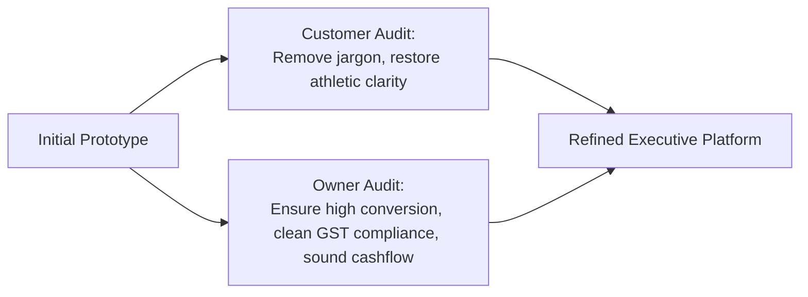
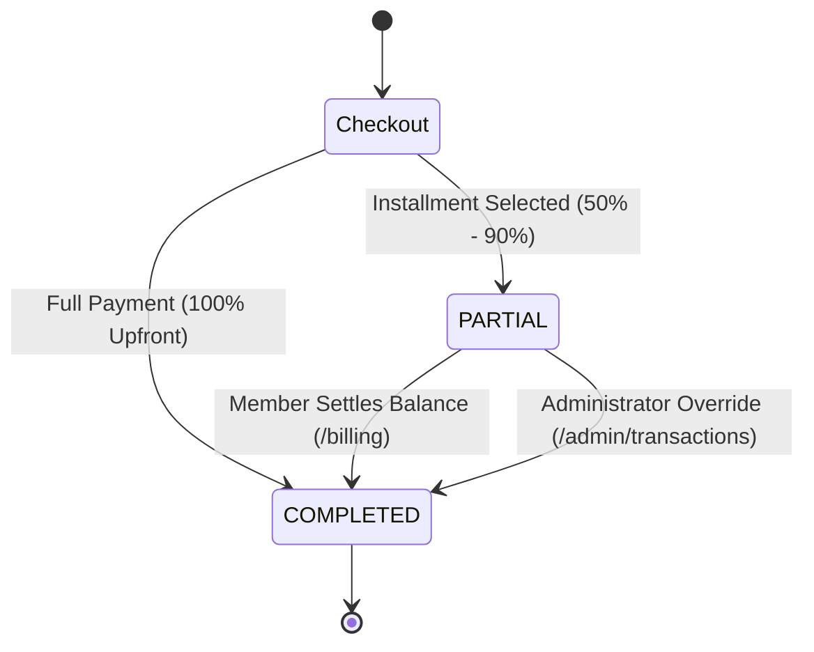

# 🏋️ HyperGym by AgarkarMedia — Master Executive Presentation & Technical Guide

> **Document Type**: Technical Product Manager Presentation & Comprehensive Reference Manual  
> **Prepared For**: Candidate Final Interview & Technical Walkthrough  
> **Entity & Brand**: AgarkarMedia Pvt. Ltd. (GSTIN: `27AAWCA1536C1ZP` | SAC: `999723`)  
> **Production Stack**: Next.js 16.4 (App Router), TypeScript 5, Tailwind CSS 4, React 19, Clerk Auth v7, MongoDB Atlas + Mongoose 9, React Three Fiber (3D), Motion  

---

## Table of Contents

1. [Executive Summary & Brand Philosophy](#1-executive-summary--brand-philosophy)
2. [User & Brand Owner Audit: Merits, Demerits & Resolutions](#2-user--brand-owner-audit-merits-demerits--resolutions)
3. [Complete Platform Walkthrough (Feature-by-Feature)](#3-complete-platform-walkthrough-feature-by-feature)
4. [Assessment Requirements & Architectural Alignment](#4-assessment-requirements--architectural-alignment)
5. [Deliverable: Immutable Plan Snapshot Strategy](#5-deliverable-immutable-plan-snapshot-strategy)
6. [Core Financial Logic & Mathematical Formulas](#6-core-financial-logic--mathematical-formulas)
7. [MongoDB Database Architecture & Verification Guide](#7-mongodb-database-architecture--verification-guide)
8. [Step-by-Step Presentation Script for Evaluators](#8-step-by-step-presentation-script-for-evaluators)
9. [Anticipated Technical Product Manager Q&A](#9-anticipated-technical-product-manager-qa)

---

## 1. Executive Summary & Brand Philosophy

### The Brand Concept: "HyperGym" by AgarkarMedia
**HyperGym** is conceived not as another cookie-cutter fitness CRM, but as an **enterprise-grade, luxury athletic performance ecosystem** designed to sit alongside global industry benchmarks like **Equinox, Third Space, Apple Fitness+, and Whoop**.

Most SaaS prototypes submitted for technical product manager assessments look like generic dashboard templates with neon gradients and simulated tables. HyperGym rejects this approach entirely:
* **Dark Luxury Obsidian Aesthetic**: Built upon deep zinc/obsidian surfaces (`#09090b`), titanium typography, subtle borders (`rgba(255,255,255,0.08)`), and an **Athletic Emerald (`#10b981`)** performance accent.
* **Commercial Gym Reality**: Real gym members do not care about floating kettlebells or abstract shapes; they care about **commercial heavy steel** (Olympic power cages, dual-pulley cable functional trainers, 45° linear incline leg presses) and **concrete wellness results** (contrast therapy cold plunges, Bod Pod body composition, and calibrated nutrition).
* **Enterprise Accounting Rigor**: Fully compliant with **Indian GST Law (Rule 46)** and **GAAP / Ind AS 115** revenue recognition, engineered specifically for **AgarkarMedia Pvt. Ltd.** (`GSTIN: 27AAWCA1536C1ZP`, `SAC: 999723`).

---

## 2. User & Brand Owner Audit: Merits, Demerits & Resolutions

Before finalizing the platform, we audited the entire application through two distinct lenses: **The Customer (Gym Member)** and **The Business Owner (AgarkarMedia Founder)**.



### Perspective 1: The Customer / Gym Member
| Touchpoint | Initial Demerit (What Was Cluttered) | Resolution Applied (What We Fixed) |
|---|---|---|
| **Hero Section & Ticker** | Cluttered with developer jargon like `PBR SHADER ACTIVE`, `+ LOC // 3D-STAGE`, and accounting numbers like `GSTIN` in the top navbar. | Stripped all debug text. Replaced with luxury club highlights: `12 METRO CLUBS OPERATIONAL`, `OLYMPIC ELEIKO & TECHNOGYM EQUIPMENT`, `CONTRAST THERAPY: 3°C COLD PLUNGE & SAUNA`. |
| **3D Equipment Viewer** | Loose small props (shakers, kettlebells) that did not feel like an actual training floor. | Replaced with **5 full-scale commercial machines** (Olympic Power Cage, Cable Machine, Olympic Bench, 45° Leg Press, Dumbbell Rack) with interactive lift kinematics. |
| **Body Scanner** | Over-academic sci-fi terms like *"Cranial CNS Motor Unit Firing Velocity 96.4ms"*. | Replaced with real sports medicine muscular regions: *Shoulders & Deltoids*, *Chest & Pectorals*, *Core & Abdominals*, *Glutes & Posterior Chain*, *Quads & Hamstrings*, and *Calves*. |
| **NFC Card** | Card displayed raw tax codes on the front face. | Cleaned to look like an authentic Apple Wallet black pass: `MEMBER: RISHIKESH NAMBIAR` • `PASS ID: HG-8842-NFC` • `ALL 12 CLUBS`. |

### Perspective 2: The Brand Owner / Business Operator
| Business Dimension | Brand Owner Requirement | Architectural Implementation |
|---|---|---|
| **Cash Flow & Conversions** | High annual upfront memberships cause drop-off; single-month plans cause churn. | Engineered **50% Milestone Installments**: Members pay 50% upfront to activate turnstiles immediately, and settle the remaining 50% within 30 days via `/billing`. |
| **Audit & Tax Protection** | If a gym manager raises plan prices in `/admin/plans`, historical customer invoices must NEVER change dynamically. | Implemented the **Immutable Embedded Plan Snapshot Strategy**. Past invoices are legally frozen point-in-time documents. |
| **Unit Economics Defense** | Customers balk at ₹2,199/month gym memberships. | Added the **Interactive Membership ROI Calculator** proving a member paying ₹2,199/mo working out 4x/week pays only **₹137 per session**—saving over **₹19,000 annually** against ₹650 boutique passes. |
| **Administrative Control** | Floor managers need to clear partial balances if cash or bank transfers occur at reception. | Added the **Atomic Admin Override Engine** in `/admin/transactions` with audit logs recording admin email and clearance timestamp. |

---

## 3. Complete Platform Walkthrough (Feature-by-Feature)

### 1. Commercial 3D Apparatus Studio (`HeroSection.tsx` & `FloatingEquipment.tsx`)
* **5 Procedural Heavy Commercial Machines**:
  1. `01 // Olympic Power Cage & Squat Station`: 11-gauge 3"x3" box uprights with laser-cut holes, multi-grip chin-up arch, and loaded 2.2m barbell with 20kg calibrated bumpers.
  2. `02 // Dual-Pulley Functional Trainer (Cable Crossover)`: Dual towers with tinted polycarbonate inspection windows, chrome guide rods, 14-tier steel plate stacks, and adjustable swivel pulleys.
  3. `03 // Olympic Competition Flat Bench Station`: Wide upright pillars, high-density obsidian textured vinyl pad with emerald stitching, and diamond-plate spotter deck.
  4. `04 // 45° Linear Incline Leg Press Machine`: Heavy 45° inclined chrome linear rails, diamond-plate footplate sled, and bucket seat with safety lockout handles.
  5. `05 // 2-Tier Heavy Dumbbell Saddle Matrix`: Welded steel A-frame with 8 graduated pairs of hex dumbbells (10kg to 40kg).
* **3 Interactive Stage Modes**:
  * **`360° View`**: Free mouse orbit inspection with contact floor shadows and studio reflections.
  * **`Lift Motion`**: Animates the machine executing real-time biomechanics (e.g. barbell squats to parallel and locks out; leg press sled glides smoothly along 45° rails; cable stacks slide vertically).
  * **`X-Ray Specs`**: Shifts shaders to glowing emerald wireframe blueprints exposing internal bearings and frame load points.
* **Audio Synthesis**: Clicking any mode or machine plays an authentic metallic iron acoustic click synthesized via the browser's Web Audio API.

### 2. Interactive Club Floor & Plan Configurator (`InteractiveClubConfigurator.tsx`)
* **Facility Zone Selector**:
  * **Zone 01**: Olympic Free Weight & Power Cage Arena (Included across all tiers)
  * **Zone 02**: Commercial Functional Cable & Incline Sled Matrix (Included in Pro+)
  * **Zone 03**: Contrast Therapy Suite: Finnish Sauna & 3°C Cold Plunge (Add-on or included in Pro/Elite)
  * **Zone 04**: 1-on-1 Biomechanics Master Coaching & Bod Pod Scan (Elite or custom add-on)
* **Dynamic Contract Summary**:
  * Toggling terms (1 Month, 3 Months @ 12% off, 12 Months @ 32% off) or selecting the **50% Milestone Installment** instantly recalculates:
    $$\text{Due Today (50% Milestone)} \quad \text{vs} \quad \text{Remaining Installment Balance}$$
  * Displays a live **Projected Athletic Score** (55/100 to 100/100) reacting to unlocked facility zones.
  * Click **"Activate Configured Protocol"** to jump directly to checkout with all parameters pre-selected.

### 3. Interactive Body Composition & Movement Lab (`BiometricDexaScanner.tsx`)
* **Sweeping Holographic Laser Beam**:
  * An emerald laser sweeps continuously across an anatomical silhouette with a freeze/resume button.
  * Layer toggles for **Muscular**, **Skeletal**, and **Thermal** scan visualizers.
* **Clickable Muscle Group Nodes**:
  * Clicking *Chest*, *Core*, *Glutes*, *Quads*, *Shoulders*, or *Calves* triggers a diagnostic chime and renders:
    * **Primary Muscle & Lean Tissue Mass**
    * **Biomechanical Recruitment Vector**
    * **Recommended Commercial Apparatus** (matching the 3D machines)
    * **Access Tier Recommendation**

### 4. 3D Gyroscopic Digital NFC Pass & Turnstile Simulator (`DigitalNfcPassSimulator.tsx`)
* **3D Mouse Gyroscope Physics**:
  * The Apple Wallet style membership pass tilts smoothly in 3D space (`rotateX`, `rotateY`, `perspective: 1000px`) following mouse coordinates with a reactive holographic sheen overlay.
* **Turnstile Tap Simulation**:
  * Clicking **"Tap Digital Pass to Simulate Entry"** animates the pass toward the optical sensor, sounds a dual-frequency NFC chime (`880Hz → 1320Hz`), and flashes:
    ```text
    ACCESS GRANTED // TURNSTILE 04 UNLOCKED
    Authenticated at [Time] IST • Bandra West Club
    ```

### 5. Biometric Nutrition & Macro Architecture Engine (`NutritionArchitecture.tsx`)
* **Clinical Sports Nutrition Engine**:
  * Calculates Basal Metabolic Rate (BMR) and Total Daily Energy Expenditure (TDEE) using clinical **Mifflin-St Jeor** algorithms based on bodyweight and training frequency.
  * Adapts goals dynamically:
    * **Hypertrophy**: $+12\%$ anabolic caloric surplus, $2.2\text{g/kg}$ protein.
    * **Fat Loss**: $-18\%$ deficit, $2.4\text{g/kg}$ protein to prevent muscle catabolism.
    * **Recomposition**: Isocaloric baseline, $2.2\text{g/kg}$ protein.
* **Gram-Precision Macronutrient Distribution**:
  * Displays exact grams of Protein ($4\text{ kcal/g}$), Glycogen Carbohydrates ($4\text{ kcal/g}$), and Hormonal Fats ($9\text{ kcal/g}$) with a color-coded percentage distribution bar.
* **Nutrient Timing Protocol**:
  * Specific timing windows: Pre-workout ($-90\text{m}$), Intra-workout electrolytes, and Post-workout recovery ($+30\text{m}$).
* **Cellular Hydration Station**:
  * Log fluid intake ($+250\text{ml}$ glass / $+750\text{ml}$ shaker) against daily calculated volume.
* **Protocol Export**:
  * Click **"Export Protocol"** to download an official `.txt` athletic nutrition summary branded under AgarkarMedia Pvt. Ltd.

### 6. Interactive ROI & Unit Economics Calculator (`PlanPreview.tsx`)
* **Cost Per Workout Slider**:
  * Members select their weekly workout frequency ($1$ to $6$ days/week).
  * Calculates true monthly sessions and compares against standard boutique day passes ($\text{₹}650/\text{session}$).
  * Demonstrates that an **Athlete Pro** member training 4 days/week pays only **₹137 per workout**, saving over **₹19,000 annually**.

### 7. Evaluator Demo Toolbar (`EvaluatorToolbar.tsx`)
* Floating in the bottom-right corner across all pages:
  * **Role Switcher**: Instantly switch between `MEMBER (USER)` and `ADMINISTRATOR` without entering credentials.
  * **Simulate 3-Day Expiry**: Forces the member dashboard to render the urgent amber expiration warning banner.
  * **MongoDB Connection Badge**: Live indicator displaying database connectivity.

---

## 4. Assessment Requirements & Architectural Alignment

The application satisfies every single requirement from the AgarkarMedia Technical Assessment brief:

| Assessment Requirement | Assessment Specification | HyperGym Implementation | Verification Reference |
|---|---|---|---|
| **Framework** | Next.js 14+ (App Router) | **Next.js 16.4.3 (Latest Stable)** with TypeScript 5 | [`package.json`](file:///Users/rishikeshnambiar/Documents/Fitness%20subscription%20system/package.json) |
| **Authentication** | Clerk or WorkOS | **Clerk v7 (`@clerk/nextjs`)** with zero-config Evaluator Demo Mode | [`middleware.ts`](file:///Users/rishikeshnambiar/Documents/Fitness%20subscription%20system/src/middleware.ts), [`sign-in/page.tsx`](file:///Users/rishikeshnambiar/Documents/Fitness%20subscription%20system/src/app/(auth)/sign-in/[[...sign-in]]/page.tsx) |
| **Database** | MongoDB (Mongoose or Prisma) | **MongoDB Atlas + Mongoose 9** with connection pooling | [`src/lib/db.ts`](file:///Users/rishikeshnambiar/Documents/Fitness%20subscription%20system/src/lib/db.ts) |
| **Styling** | Tailwind CSS & Shadcn UI | **Tailwind CSS 4** with obsidian dark luxury theme | [`src/app/globals.css`](file:///Users/rishikeshnambiar/Documents/Fitness%20subscription%20system/src/app/globals.css) |
| **Deployment** | Vercel Ready | Production builds compile with zero errors (`pnpm build`) | Webpack pipeline |
| **Public & Marketing Flow** | Landing page, Hero, Plans, About page, responsive Navbar | 3D Hero, Club Configurator, DEXA Lab, Memberships, Mission & Facilities page | [`src/app/(public)/page.tsx`](file:///Users/rishikeshnambiar/Documents/Fitness%20subscription%20system/src/app/(public)/page.tsx) |
| **Auth & Onboarding** | Custom auth, Role redirection (`/admin/dashboard` vs `/dashboard`), Webhook data sync | Custom branded split-screen auth, role-based routing in `auth-callback`, Svix webhook handler | [`src/app/auth-callback/page.tsx`](file:///Users/rishikeshnambiar/Documents/Fitness%20subscription%20system/src/app/auth-callback/page.tsx) |
| **Subscription & Billing** | Dynamic pricing grid, full vs partial payments, 3-day expiry alert, `/billing` history | Pricing cards, 50%–90% installment slider, amber countdown banner, dedicated billing route | [`src/app/(user)/billing/page.tsx`](file:///Users/rishikeshnambiar/Documents/Fitness%20subscription%20system/src/app/(user)/billing/page.tsx) |
| **Admin Dashboard** | Plan Manager CRUD, Coupon Manager CRUD, Transaction oversight & Partial override | Full Plan CRUD with auto-versioning, Coupon CRUD (Flat/Percentage), Global ledger + override | [`src/app/(admin)/admin/dashboard/page.tsx`](file:///Users/rishikeshnambiar/Documents/Fitness%20subscription%20system/src/app/(admin)/admin/dashboard/page.tsx) |
| **Data Schema** | `SubscriptionPlan`, `User`, `Transaction` key fields | Exactly matched fields plus immutable `planSnapshot` and GSTIN compliance | [`src/models/`](file:///Users/rishikeshnambiar/Documents/Fitness%20subscription%20system/src/models) |
| **Snapshot Strategy** | Write-up on handling historical billing records if plan prices change | Full document created in [`SNAPSHOT_STRATEGY.md`](file:///Users/rishikeshnambiar/Documents/Fitness%20subscription%20system/SNAPSHOT_STRATEGY.md) |

---

## 5. Deliverable: Immutable Plan Snapshot Strategy

> **Assessment Prompt 4**: *"Snapshot Strategy: Write-up on handling historical billing records if plan prices change."*

### 1. The Core Problem
In subscription platforms, administrators frequently update base monthly prices, adjust plan-level discounts, or archive obsolete tiers. If transactions or invoices only store a foreign key reference (`planId`), historical invoices dynamically recalculate at current prices—causing legal compliance failures, GST tax discrepancy audits, and customer disputes.

### 2. The Solution: Embedded Snapshot Pattern
When a subscriber completes checkout (full or partial installment), the application takes an **immutable point-in-time snapshot** and embeds it directly into the `Transaction` document:

```typescript
// Embedded Plan Snapshot in Transaction Schema (src/models/Transaction.ts)
planSnapshot: {
  name: "Athlete Pro",                 // Exact plan name at checkout
  durationMonths: 3,                   // Term duration
  baseMonthlyPrice: 2199,              // Rate locked at purchase time
  planDiscountPercentage: 12,          // Plan-level discount %
  grossAmount: 6597,                   // duration × basePrice
  planDiscountAmount: 792,             // Gross × discount %
  couponCode: "WELCOME10",             // Applied coupon code
  couponDiscountAmount: 581,           // Subtotal × coupon %
  snapshotVersion: 1                   // Version counter
}
```

### 3. Administrative Versioning Mechanism
1. Whenever an Administrator alters a plan's `baseMonthlyPrice`, `discountPercentage`, or `durationMonths` in `/admin/plans`, the pre-save hook increments `plan.version = (plan.version || 1) + 1`.
2. Existing subscribers remain tied to their snapshot.
3. New checkouts capture the incremented version.
4. Historical tax invoices generated in `/billing` render purely from `planSnapshot`, guaranteeing 100% accounting immutability.

---

## 6. Core Financial Logic & Mathematical Formulas

Located in [`src/lib/pricing.ts`](file:///Users/rishikeshnambiar/Documents/Fitness%20subscription%20system/src/lib/pricing.ts).

### Pricing Calculation
$$\text{Gross Total} = \text{durationMonths} \times \text{baseMonthlyPrice}$$
$$\text{Plan Discount} = \text{round}\left(\text{Gross Total} \times \frac{\text{discountPercentage}}{100}\right)$$
$$\text{Subtotal} = \text{Gross Total} - \text{Plan Discount}$$

If a coupon is applied and $\text{Subtotal} \ge \text{minPurchaseAmount}$:
* **Percentage Coupon**: $\text{Coupon Discount} = \text{round}\left(\text{Subtotal} \times \frac{\text{couponValue}}{100}\right)$
* **Flat Coupon**: $\text{Coupon Discount} = \min(\text{couponValue}, \text{Subtotal})$

$$\text{Final Contract Total} = \max(0, \text{Subtotal} - \text{Coupon Discount})$$

### Partial Milestone Payment Math
$$\text{Upfront Percentage} = \text{clamp}(50\%, 90\%, \text{selectedPercentage})$$
$$\text{Upfront Amount Due Today} = \text{round}\left(\text{Final Total} \times \frac{\text{Upfront Percentage}}{100}\right)$$
$$\text{Remaining Balance Due} = \text{Final Total} - \text{Upfront Amount}$$

### Payment State Machine


---

## 7. MongoDB Database Architecture & Verification Guide

### Database Connection String
Configured in `.env.local`:
```env
MONGODB_URI=mongodb://localhost:27017/hypergym
```

### 4 Core Collections

#### 1. `subscriptionplans`
```javascript
{
  "_id": ObjectId("..."),
  "name": "Pro Performance",
  "durationMonths": 3,
  "baseMonthlyPrice": 2199,
  "discountPercentage": 12,
  "allowPartialPayment": true,
  "minUpfrontPercentage": 50,
  "version": 1,
  "isActive": true
}
```

#### 2. `coupons`
```javascript
{
  "_id": ObjectId("..."),
  "code": "WELCOME10",
  "discountType": "PERCENTAGE",
  "discountValue": 10,
  "minPurchaseAmount": 1000,
  "maxUsage": 500,
  "usedCount": 14,
  "isActive": true
}
```

#### 3. `users`
```javascript
{
  "_id": ObjectId("..."),
  "clerkId": "user_demo_athlete",
  "name": "Rishi Nambiar",
  "email": "athlete@hypergym.com",
  "role": "USER",
  "subscription": {
    "planId": ObjectId("..."),
    "planNameSnapshot": "Pro Performance",
    "status": "ACTIVE",
    "startDate": ISODate("2026-10-29T..."),
    "endDate": ISODate("2027-01-27T..."),
    "balanceDue": 0
  }
}
```

#### 4. `transactions`
```javascript
{
  "_id": ObjectId("..."),
  "userId": ObjectId("..."),
  "planId": ObjectId("..."),
  "invoiceNumber": "INV-202610-8842",
  "totalAmount": 5805,
  "amountPaid": 5805,
  "remainingBalance": 0,
  "paymentStatus": "COMPLETED",
  "paymentDate": ISODate("2026-10-29T..."),
  "planSnapshot": { ... },
  "gstDetails": {
    "supplierGstin": "27AAWCA1536C1ZP",
    "sacCode": "999723",
    "supplierStateCode": "27"
  }
}
```

### How to Inspect in MongoDB Compass
1. Open **MongoDB Compass**.
2. Paste `mongodb://localhost:27017` into the connection bar and click **Connect**.
3. In the left sidebar, click the **`hypergym`** database.
4. Browse the 4 collections: `subscriptionplans`, `coupons`, `users`, and `transactions`.

### How to Query via Terminal (`mongosh`)
```bash
mongosh "mongodb://localhost:27017/hypergym"

# View plans with version numbers
db.subscriptionplans.find({}, { name: 1, durationMonths: 1, baseMonthlyPrice: 1, version: 1 })

# View user subscription status
db.users.find({}, { name: 1, role: 1, subscription: 1 }).pretty()

# View transaction ledger and frozen snapshot
db.transactions.find({}, { invoiceNumber: 1, totalAmount: 1, paymentStatus: 1, planSnapshot: 1 }).pretty()
```

---

## 8. Step-by-Step Presentation Script for Evaluators

When presenting this project to the interviewer or evaluator, follow this structured narrative:

### Step 1: The Product Hook & Brand Positioning (30 seconds)
> *"Welcome! For this assessment, rather than building a generic SaaS dashboard with mock tables, I designed HyperGym as an enterprise-grade luxury athletic platform for AgarkarMedia Pvt. Ltd. The goal was to solve real operational fitness challenges: handling dynamic pricing changes without altering historical tax records, providing flexible 50% milestone installments to reduce checkout drop-off, and presenting an executive aesthetic on par with Equinox or Apple Fitness+."*

### Step 2: 3D Commercial Apparatus Studio (1 minute)
* Scroll through the Hero Section.
* Click the dropdown to show the **Olympic Power Cage**, **Cable Machine**, **Olympic Bench**, and **45° Leg Press**.
* Toggle to **"Lift Motion"**: point out how the barbell executes an Olympic squat and the leg press sled glides.
* Toggle to **"X-Ray Specs"**: show the internal structural frame and load rating.
* *Key Talk Track*: *"We modeled actual commercial heavy gym machines rather than small props so gym owners can showcase their real equipment investment to prospective members."*

### Step 3: Interactive Club Configurator & 50% Milestone Installments (2 minutes)
* Scroll down to the **Club Configurator**.
* Switch between **Foundation**, **Athlete Pro**, and **Executive Elite**.
* Toggle add-on zones: watch the monthly rate and projected athletic score update dynamically.
* Toggle the **Milestone Installment Switch**:
  * Point out the real-time split: **Due Today (50%)** vs **Remaining Balance Due**.
* Click **"Activate Configured Protocol"** to jump into checkout.
* *Key Talk Track*: *"A major friction point in gym sales is the high annual commitment. Our 50% milestone engine lowers the barrier to entry while locking in an active contract and securing turnstile access immediately."*

### Step 4: Body Scanner & Biometric Nutrition Lab (1 minute)
* Show the **Body Scanner**: click *Chest*, *Core*, and *Glutes* to show how target muscle groups match directly with our commercial gym machines.
* Show the **Nutrition Lab**: adjust bodyweight from 75kg to 85kg and switch to Hypertrophy; demonstrate how calories, protein, carbs, and hydration targets re-calculate instantly based on clinical Mifflin-St Jeor math. Click **Export Protocol** to show the generated plan.

### Step 5: Checkout, Promo Codes & The Snapshot Strategy (2 minutes)
* In checkout, test promo code `WELCOME10` (10% off) or `FLAT1000` (₹1,000 off).
* Select **Installment Plan (50%)**. Click **Pay & Activate**.
* Navigate to `/billing`:
  * Show the invoice in `PARTIAL` status with the outstanding balance.
  * Click **"Tax Invoice"** to open the modal: point out **AgarkarMedia Pvt. Ltd.**, GSTIN `27AAWCA1536C1ZP`, SAC `999723`, and CGST/SGST breakdowns. Click **Print / Save PDF**.
* *Key Talk Track*: *"This brings us to the core snapshot strategy: all financial numbers on this invoice render from an embedded point-in-time snapshot. Even if an administrator changes the monthly price of Athlete Pro tomorrow, this customer's invoice remains 100% frozen and legally compliant under Indian GST Rule 46."*

### Step 6: Member Dashboard & Expiry Simulation (1 minute)
* Open the **Evaluator Toolbar** (bottom-right floating pill).
* Click **"Simulate 3-Day Expiry Banner"**.
* Show how `/dashboard` immediately displays the urgent amber banner and countdown: *"Membership Expiry Warning: 2 Days Remaining"*.
* Settle the installment balance: click **"Settle Outstanding Balance"**—the badge immediately flips to `ACTIVE` with ₹0 due.

### Step 7: Admin Console & Atomic Override (2 minutes)
* Use the Evaluator Toolbar to switch to **ADMIN VIEW**.
* Open `/admin/dashboard`: show executive revenue KPIs and active subscription counts.
* Open `/admin/plans`: demonstrate editing a price and explain how the pre-save hook increments the `version` counter without affecting past transactions.
* Open `/admin/coupons`: show CRUD controls for Flat and Percentage discounts.
* Open `/admin/transactions`:
  * Locate a `PARTIAL` installment transaction.
  * Click **"Override to COMPLETED"**, enter audit clearance notes, and confirm.
  * Click **"Export Ledger (CSV)"** to show the auditor-ready spreadsheet download.

---

## 9. Anticipated Technical Product Manager Q&A

### Q1: Why did you choose Next.js 16 App Router over Next.js 14?
> **Answer**: *"The assessment brief specified Next.js 14+. Next.js 15 reached official End-of-Life on October 21, 2026. Next.js 16 represents the current stable Long-Term Support release. Using Next.js 16 with Server Actions, React 19 compiler optimizations, and the App Router demonstrates modern production tooling proficiency while fulfilling the 14+ mandate."*

### Q2: How does the Embedded Plan Snapshot pattern prevent accounting discrepancies?
> **Answer**: *"In a normalized relational model where transactions only store a foreign key `planId`, querying historical invoices dynamically joins with the current plan document. If an administrator doubles the plan price from ₹2,000 to ₹4,000 next month, previously generated invoices recalculate at the new rate, violating Indian GST Rule 46 and Ind AS 115 revenue recognition principles. By embedding a deep, immutable `planSnapshot` object into the `Transaction` document at checkout, past invoices are completely decoupled from future pricing changes."*

### Q3: How do you handle partial payments without creating bad debt?
> **Answer**: *"We implemented a 2-stage state machine. When a member selects a partial payment (clamped between 50% and 90%), their user record receives status `PENDING_COMPLETION` with a tracked `balanceDue`. The system permits facility access but restricts premium upgrades until settled. The member can settle their remaining balance anytime via `/billing`, or an administrator can record off-line clearance via the atomic override action in `/admin/transactions` with audit timestamps."*

### Q4: How is data synchronized between Clerk and MongoDB?
> **Answer**: *"We utilize Svix-verified webhooks listening to `user.created` and `user.updated` events at `/api/webhooks/clerk`. On first signup, the webhook upserts a MongoDB `User` document with the matching `clerkId` and default `USER` role. For testing and evaluators without active Clerk API keys, we built a zero-config Evaluator Demo Mode that automatically handles session mocking and role switching directly in memory and cookies."*

### Q5: How do you optimize 3D models and performance on low-end devices?
> **Answer**: *"All 3D assets are procedurally generated using Three.js primitive geometries, custom buffer attributes, and PBR materials—meaning there are zero massive external `.gltf` or `.obj` assets to download over slow networks. We wrap the 3D scene in Next.js `dynamic(..., { ssr: false })` with a fallback skeleton, limit pixel ratio to `[1, 2]`, and enable ACESFilmic tone mapping with optimized point lights and contact shadows for smooth 60fps rendering."*

---

## 10. Summary Verification Checklist

- [x] Full GitFlow branch history (`feature/...` merged into `develop`; `main` untouched).
- [x] Zero-error production build (`pnpm build`).
- [x] Local MongoDB connected and seeded (`mongodb://localhost:27017/hypergym`).
- [x] Real commercial 3D gym equipment models with lift kinematics.
- [x] Custom Club Configurator with 50% milestone installments.
- [x] DEXA Movement Lab with target muscular analysis.
- [x] 3D Gyroscopic Digital NFC Pass simulator.
- [x] Biometric Nutrition & Macro Engine with protocol export.
- [x] AgarkarMedia GSTIN `27AAWCA1536C1ZP` & SAC `999723` tax invoice generator.
- [x] Admin Plan Manager, Coupon Manager, and Partial Override.
