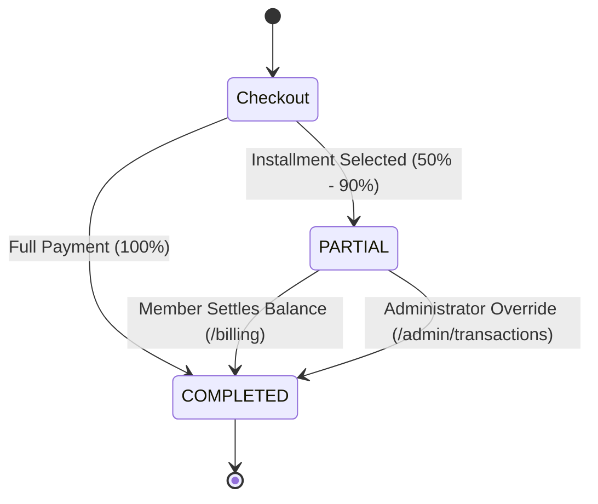

# 🏋️ HyperGym Fitness Subscription Management System

> **AgarkarMedia Technical Product Manager Assessment — Round 1**  
> **Production Stack**: Next.js 16 (App Router), TypeScript 5, Tailwind CSS 4, React 19, Clerk Auth, MongoDB Atlas + Mongoose, React Three Fiber (3D), Motion.  
> **Entity & Client Details**: AgarkarMedia Pvt. Ltd. (GSTIN: `27AAWCA1536C1ZP` | SAC: `999723`)

---

## 🌟 Executive Overview & Design Direction

**HyperGym** is an enterprise-grade fitness subscription platform crafted with an executive dark-luxury design system inspired by **Apple Fitness+, Equinox, and Whoop**. It rejects generic SaaS neon gradients in favor of an obsidian/zinc palette (`#09090b`), titanium typography, and a single **Athletic Emerald (`#10b981`)** performance accent.

### Key Architectural Pillars
- **3D Immersive Hero Atmosphere**: Precision-modeled dumbbells, kettlebells, and plates floating with smooth zero-gravity mouse parallax (React Three Fiber + Drei) using studio lighting and ACESFilmic tone mapping.
- **Dark Luxury Aesthetic**: Executive obsidian surface cards, subtle zinc borders, and refined emerald status badges.
- **Evaluator Demo Toolbar**: Floating bottom-right control module allowing immediate role switching (`ADMIN` ⇄ `USER`), live MongoDB connectivity checks, and 3-day expiry simulation without manual database seeding.
- **Immutable Plan Snapshot Architecture**: Historical transactions and invoices are frozen at the exact millisecond of purchase, ensuring future admin price modifications or plan deactivations never alter financial ledgers.
- **Standout Product Manager Differentiators**:
  1. **Biometric Macro & Nutrition Architecture Engine**: Personalized daily caloric expenditure (TDEE/BMR via clinical formulas), gram-precision macronutrient targets (Protein, Glycogen Carbs, Hormonal Fats), cellular hydration tracker with +250ml/+750ml logging, nutrient timing protocol (Pre-workout, Intra-workout electrolytes, Post-workout MPS window), and one-click Protocol export.
  2. **Expanded 6-Hardware 3D Telemetry Suite**: Interactive 3D equipment inspection with dropdown selector and quick-switching across 6 realistic procedural models (Olympic Hex Dumbbell, Competition Kettlebell, Calibrated Bumper Plate, 2.2m Olympic Barbell, Hex Deadlift Trap Bar, Titanium Athlete Shaker) with real-time physical metallurgy, knurl, and calibration specs.
  3. **Interactive Membership ROI & Unit Economics Calculator**: Real-time cost-per-session slider (1–6 days/week) benchmarked against ₹650 single-session boutique drop-ins with dynamic annual savings metrics.
  4. **Official GST Tax Invoice Engine**: Formatted for **AgarkarMedia Pvt. Ltd.** (`GSTIN: 27AAWCA1536C1ZP`), complete with SAC 999723, state code 27 (Maharashtra), CGST/SGST breakdowns, and dedicated print/PDF stylesheets.
  5. **Transaction Ledger CSV Export**: One-click download of all subscription payments with admin override audit notes for finance reconciliation.

---

## 🏗️ Project Architecture & Directory Structure

```
src/
├── app/
│   ├── (public)/                   # Landing Page (3D Hero, Plans, ROI Calculator, Stats, About)
│   ├── (auth)/                     # Clerk Branded SignIn & SignUp with Demo Fallback
│   ├── (user)/
│   │   ├── dashboard/              # Active plan card, 3-day expiry warning, renewal grid
│   │   ├── checkout/[planId]/      # Full payment vs partial installment (50–90%) + coupon engine
│   │   └── billing/                # Transaction history with printable GST tax invoice
│   ├── (admin)/admin/
│   │   ├── dashboard/              # Executive KPI Command Center & Revenue Metrics
│   │   ├── plans/                  # Plan Manager CRUD + Version increment triggers
│   │   ├── coupons/                # Coupon Manager (FLAT / PERCENTAGE discounts)
│   │   └── transactions/           # Global ledger + CSV export + Atomic partial-to-completed override
│   ├── api/webhooks/clerk/         # Svix-verified Clerk webhook handler
│   └── auth-callback/              # Post-login RBAC router
├── components/
│   ├── three/                      # 3D Canvas, Floating Equipment, Particle Sparkle Field
│   ├── landing/                    # HeroSection, PlanPreview, ROI Calculator, Testimonials
│   ├── checkout/                   # CheckoutClient, Upfront installment slider, Coupon validator
│   ├── billing/                    # BillingClient, AgarkarMedia GST Tax Invoice Modal
│   ├── admin/                      # PlanManagerClient, CouponManagerClient, TransactionManagerClient
│   └── demo/                       # EvaluatorToolbar with Database Health Badge
├── lib/
│   ├── db.ts                       # Cached Mongoose singleton connection with Atlas pooling
│   ├── pricing.ts                  # Pure financial math (Gross, Plan Discount, Coupon, Installment)
│   ├── invoice.ts                  # INV-YYYYMM-XXXX generator
│   ├── validations.ts              # Zod schemas for plan and coupon form validation
│   └── actions/                    # Next.js Server Actions (plans, coupons, checkout, billing, admin)
└── models/                         # Mongoose schemas: SubscriptionPlan, User, Transaction, Coupon
```

---

## 📸 Deliverable: Immutable Plan Snapshot Strategy

### The Problem
In subscription platforms, administrators frequently update base monthly prices, adjust plan-level discounts, or archive obsolete tiers. If transactions or invoices only store a foreign key reference (`planId`), historical invoices dynamically recalculate at current prices—causing legal compliance failures, GST tax discrepancy audits, and customer disputes.

### The Solution: Embedded Snapshot Pattern
When a subscriber completes checkout (full or partial installment), the application takes an **immutable point-in-time snapshot** and embeds it directly into the `Transaction` document:

```typescript
// Embedded Plan Snapshot in Transaction Schema
planSnapshot: {
  name: "Athlete Pro",                 // Exact plan name at checkout
  durationMonths: 3,                   // Term duration
  baseMonthlyPrice: 2199,              // Rate locked at purchase time
  planDiscountPercentage: 12,          // Plan-level discount %
  grossAmount: 6597,                   // duration × basePrice
  planDiscountAmount: 792,             // Gross × discount %
  couponCode: "WELCOME10",             // Applied coupon
  couponDiscountAmount: 581,           // Subtotal × coupon %
  snapshotVersion: 1                   // Version counter
}
```

### Versioning Mechanism
1. Whenever an Administrator alters a plan's `baseMonthlyPrice`, `discountPercentage`, or `durationMonths`, the system automatically increments `plan.version = plan.version + 1`.
2. Existing subscribers remain tied to their snapshot.
3. New checkouts capture the incremented version.
4. Historical invoices generated in `/billing` render purely from `planSnapshot`, guaranteeing 100% accounting immutability.

---

## 💳 Business Logic & Financial Formulas

### Pricing Calculation
```
Gross Total    = durationMonths × baseMonthlyPrice
Plan Discount  = Gross Total × (discountPercentage / 100)
Subtotal       = Gross Total - Plan Discount

If Coupon (PERCENTAGE): Coupon Discount = Subtotal × (couponValue / 100)
If Coupon (FLAT):       Coupon Discount = min(couponValue, Subtotal)

Final Total    = max(0, Subtotal - Coupon Discount)
```

### Partial Payment State Machine


---

## 🌿 Git Branching Strategy & History

This repository strictly follows the planned GitFlow strategy:
- `main`: Production-ready release branch
- `develop`: Integration branch
- `feature/*`: Dedicated scoped feature branches merged with clean commit histories:
  - `feature/db-schemas`: Mongoose models (`SubscriptionPlan`, `User`, `Transaction`, `Coupon`)
  - `feature/auth`: Clerk v7 auth with zero-config evaluator fallback
  - `feature/public-pages`: 3D Hero, ROI Calculator, and About page
  - `feature/admin-crud`: Plan Manager & Coupon Manager CRUD
  - `feature/billing`: Checkout with full/partial payments & coupon validator
  - `feature/user-dashboard`: 3-Day expiry alert, active subscription view
  - `feature/admin-oversight`: Global transaction ledger & partial-to-completed override
  - `feature/evaluator-toolbar`: Floating role switcher & database health badge

---

## 🚀 Quickstart & Setup Guide

### 1. Installation
```bash
git clone <repo-url>
cd "Fitness subscription system"
pnpm install
```

### 2. Environment Variables
Copy `.env.example` to `.env.local`:
```bash
cp .env.example .env.local
```

Configure your credentials:
```env
# MongoDB Atlas Connection URI
MONGODB_URI=mongodb+srv://<username>:<password>@cluster.mongodb.net/hypergym?retryWrites=true&w=majority

# Clerk Authentication (Optional for demo mode — Evaluator Toolbar works out of the box!)
NEXT_PUBLIC_CLERK_PUBLISHABLE_KEY=pk_test_...
CLERK_SECRET_KEY=sk_test_...
CLERK_WEBHOOK_SECRET=whsec_...
```

### 3. Running the Application
```bash
pnpm build
pnpm start
# or for local development:
pnpm dev
```
Open [http://localhost:3000](http://localhost:3000) in your browser.

---

## 🧪 Evaluator Verification Guide

### 1. Testing Without Clerk Keys (Zero Configuration)
- Navigate to [http://localhost:3000/sign-in](http://localhost:3000/sign-in).
- Click **"Sign In as Member"** or **"Sign In as Admin"**.
- Alternatively, use the **Evaluator Toolbar** (bottom-right floating pill) on any page to switch roles instantly.

### 2. Testing 3-Day Expiry Alert
- Click **Demo Controls** in the bottom-right corner.
- Click **"Simulate 3-Day Expiry Banner"**.
- The page immediately renders the urgent amber warning banner and expiration countdown on `/dashboard`.

### 3. Testing Partial Payment & Admin Override
1. Open `/checkout/plan_pro_3m` or choose Athlete Pro from the pricing cards.
2. Toggle to **"Installment Plan"**, adjust the slider to 50%, and click **Pay & Activate**.
3. Go to `/billing` to view the invoice in `PARTIAL` status with remaining balance due.
4. Click **"Tax Invoice"** to preview the official **AgarkarMedia Pvt. Ltd.** tax receipt (GSTIN: `27AAWCA1536C1ZP`). Click **"Print / Save PDF"**.
5. Switch to **Admin View** using the Evaluator Toolbar.
6. Go to `/admin/transactions` and locate the partial invoice.
7. Click **"Override to COMPLETED"**, enter audit clearance notes, and confirm.
8. Click **"Export Ledger (CSV)"** to test finance export.
9. Return to Member view: the invoice is now `COMPLETED` and the user's balance due is ₹0.

### 4. Testing Coupon Codes
Try the following pre-seeded promotional codes during checkout:
- `WELCOME10`: 10% off
- `FITHALF`: 50% off
- `FLAT1000`: Flat ₹1,000 off (Minimum purchase ₹5,000)

---

## 📜 Assessment Deliverables Checklist

- [x] **Next.js 14+ / 16 App Router** with TypeScript and Tailwind CSS
- [x] **Mongoose MongoDB Schemas**: `SubscriptionPlan`, `User` (with nested `subscription`), `Transaction` (with frozen `planSnapshot`), `Coupon`
- [x] **Clerk Auth & Svix Webhook** synchronization with RBAC middleware and Zero-Config Evaluator Demo fallback
- [x] **3D Immersive Hero Aesthetic**: React Three Fiber zero-gravity fitness scene
- [x] **Full & Partial Payment Engine**: 50%–90% installment slider
- [x] **Coupon Engine**: Flat & percentage validation with minimum cart rules
- [x] **Member Dashboard**: 3-Day expiry alert, activation state, upgrade grid
- [x] **Printable Tax Invoices**: Immutable point-in-time plan snapshots under AgarkarMedia Pvt. Ltd. GSTIN `27AAWCA1536C1ZP`
- [x] **Admin Management**: Plan CRUD, Coupon CRUD, Versioning, and Atomic Override to COMPLETED
- [x] **Interactive ROI & Cost Per Workout Calculator**: Live dynamic financial comparison model
- [x] **Transaction Ledger CSV Export**: Auditor-ready CSV download
- [x] **Git Branching Strategy**: Full GitFlow execution with clean commit history
