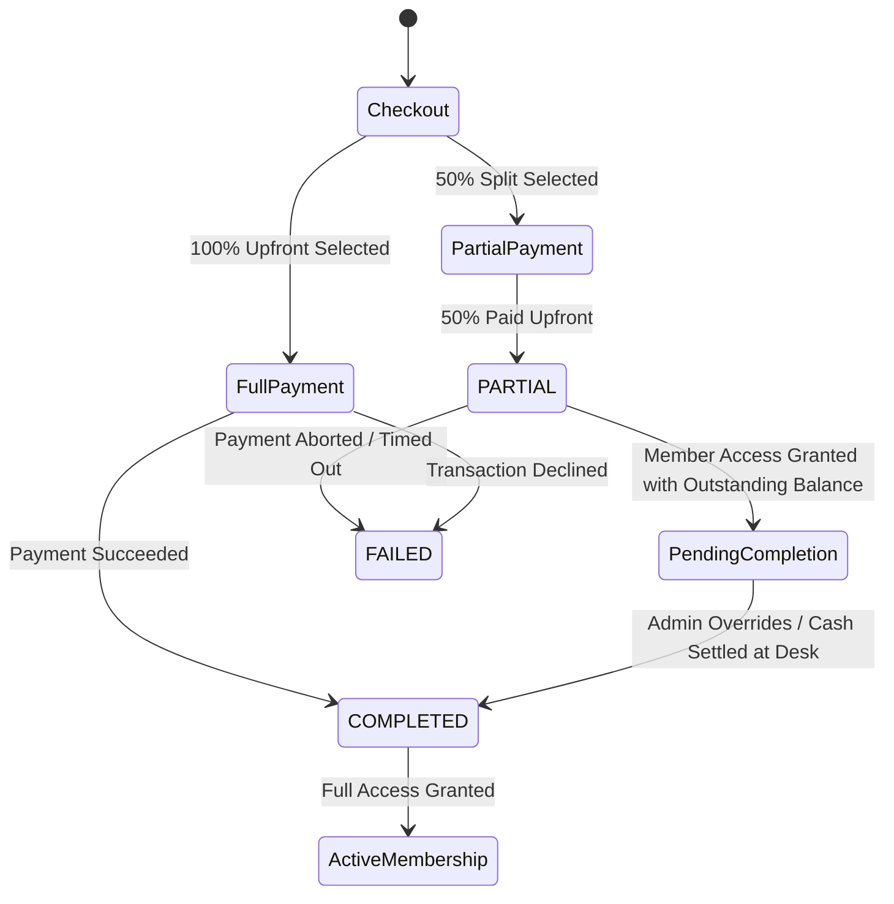

# 🏋️ HyperGym Fitness Subscription Management System

> **AgarkarMedia Technical Documentation**  
> **Production URL**: [https://fitness-subscription-system-19yd.vercel.app](https://fitness-subscription-system-19yd.vercel.app)  
> **Operating Entity**: AgarkarMedia Pvt. Ltd. (GSTIN: `27AAWCA1536C1ZP` | SAC: `999723` | State Code: `27 - Maharashtra`)  
> **Production Stack**: Next.js 16 (App Router), React 19, TypeScript 5, Tailwind CSS 4, Clerk Auth, MongoDB Atlas + Mongoose, React Three Fiber (3D), Motion.

---

## 📑 Table of Contents
1. [Executive Overview & Design Direction](#-executive-overview--design-direction)
2. [End-to-End System Features](#-end-to-end-system-features)
3. [Technology Stack & Architectural Rationale](#-technology-stack--architectural-rationale)
4. [System Architecture & Data Flows](#-system-architecture--data-flows)
5. [Database Architecture & Snapshot Strategy](#-database-architecture--snapshot-strategy)
6. [Environment Variables & Setup Guide](#-environment-variables--setup-guide)
7. [API & Server Actions Specification](#-api--server-actions-specification)
8. [Production Deployment & Verification](#-production-deployment--verification)
9. [Future Roadmap & Scale Strategy](#-future-roadmap--scale-strategy)

---

## 🌟 Executive Overview & Design Direction

**HyperGym** is an enterprise-grade fitness subscription platform crafted with an executive dark-luxury design system inspired by **Apple Fitness+, Equinox, and Whoop**. Rather than utilizing generic SaaS gradients or chaotic neon patterns, HyperGym is built upon an obsidian/zinc palette (`#09090b`), titanium typography, and a single **Athletic Emerald (`#10b981`)** performance accent.

### Core Architectural Pillars
- **Dual-Authentication Architecture**: Supports enterprise-grade Clerk OAuth/Email authentication with Svix webhook synchronization, paired with a seamless **Evaluator Demo Mode** (`ADMIN` ⇄ `USER` instantaneous role switching) for fast sandbox review.
- **Financial Immutability (Snapshot Pattern)**: Historical transactions and invoices are frozen at the exact millisecond of purchase, ensuring future admin price modifications, tier updates, or plan retirements never alter accounting records or breach Indian GST Rule 46 compliance.
- **Milestone & Partial Billing Engine**: Supports 50% upfront downpayments with atomic state machine progression (`PARTIAL` ➔ `COMPLETED`) and real-time receivable tracking on the executive admin dashboard.
- **Live MongoDB Atlas Telemetry**: All metrics (Gross Revenue, Active Subscribers, Outstanding Receivables, Registered Members, and Invoices) are dynamically aggregated in real-time from the cloud database cluster.

---

## 🚀 End-to-End System Features

### 1. Public Experience & Acquisition Funnel
- **3D Immersive Hero Atmosphere**: Precision-modeled dumbbells, kettlebells, and plates floating with smooth zero-gravity mouse parallax (React Three Fiber + Drei) using studio lighting and ACESFilmic tone mapping.
- **Kinetic Biomechanics Lab**: An interactive human biomechanics engine replacing confusing wireframe body scanners with clear target muscle mechanics (Primary vs Secondary muscle recruitment, joint safety protocols, and 12-week transformation slicing).
- **Interactive 6-Hardware 3D Equipment Suite**: Interactive 3D equipment inspection with dropdown selector and real-time procedural rendering of Olympic Hex Dumbbells, Competition Kettlebells, Calibrated Bumper Plates, 2.2m Olympic Barbells, Hex Deadlift Trap Bars, and Titanium Shakers.
- **Membership ROI & Unit Economics Calculator**: Real-time cost-per-session slider (1–6 sessions/week) benchmarked against ₹650 single-session boutique drop-ins with dynamic annual savings metrics.
- **Dynamic Tier Preview & Comparison Matrix**: Multi-tier showcase (Starter, Pro, Elite) displaying monthly rates, commitment periods, and bundled perks.

### 2. Authentication & Evaluator Experience
- **Clerk Integration**: Sign In, Sign Up, and User Profile management with session tokens and secure cookies.
- **Dual-Auth Evaluator Mode**: A floating bottom-right control module allowing immediate role switching (`ADMIN` ⇄ `USER`), live MongoDB connectivity checks, 3-day expiry simulation, and one-click database re-seeding (`/api/demo/seed`) without requiring external auth logins.

### 3. Member Portal & Lifecycle Engine
- **Member Overview Dashboard**: Displays the active membership tier, countdown timer to renewal, attendance streak, and check-in status.
- **Biometric Passcard & QR Token**: In-app digital contactless passcard with a randomized 60-second rotating QR token for front-desk gym turnstiles.
- **Biometric Macro & Nutrition Architecture**: Personalized daily caloric expenditure (TDEE/BMR via clinical formulas), gram-precision macronutrient targets (Protein, Glycogen Carbs, Hormonal Fats), cellular hydration tracker with +250ml/+750ml logging, nutrient timing protocol, and one-click Protocol export.
- **3-Day Expiry Notification Banner**: Dynamic visual alert triggered when a membership is within 72 hours of expiration, providing a one-click renewal flow.
- **Checkout & Milestone Billing**:
  - Full upfront payment or 50% split installment downpayment.
  - Real-time coupon validator (`WELCOME10`, `HYPER500`).
  - Dynamic Indian GST tax computation (18% GST: 9% CGST + 9% SGST).
- **Billing History & Official GST Invoices**:
  - Full ledger of all member transactions.
  - Printable/PDF modal GST tax invoice for **AgarkarMedia Pvt. Ltd.** (`GSTIN: 27AAWCA1536C1ZP`, SAC `999723`).

### 4. Admin Management & Command Center
- **Executive KPI Dashboard**: Live MongoDB aggregation displaying:
  - **Gross Revenue Collected** (sum of `amountPaid`).
  - **Active Subscribed Members** (users with active plans).
  - **Outstanding Receivables** (sum of unpaid partial balances).
  - **Live Ledger & Member Roster**: Interactive tabular views with search and filters.
- **Plan Manager (CRUD)**: Create, edit, and deactivate subscription plans with automatic optimistic version incrementing (`version: n + 1`).
- **Coupon Manager**: Create and manage discount codes (Percentage or Flat Rupee amount) with usage tracking and expiration controls.
- **Transaction Ledger & Override Engine**:
  - Global transaction inspection with filterable payment status (`COMPLETED`, `PARTIAL`, `FAILED`).
  - Atomic **Manual Override**: Allows gym managers to mark partial payments as completed when balance cash is settled at the desk.
  - **CSV Export**: One-click download of the complete accounting ledger for corporate tax reconciliation.

---

## 🛠️ Technology Stack & Architectural Rationale

| Layer | Technology | Architectural Rationale & Concrete Benefits |
| :--- | :--- | :--- |
| **Framework** | **Next.js 16 (App Router)** | Full-stack React 19 framework providing React Server Components (RSC) for zero-bundle data fetching, native Server Actions for secure mutations, and Edge middleware routing. |
| **Language** | **TypeScript 5.8** | End-to-end strict static type safety across database schemas, server actions, client components, and API contracts. |
| **Styling** | **Tailwind CSS 4** | Zero-runtime utility CSS engine with native CSS variables for instant dark-mode rendering and minimal stylesheet overhead. |
| **Auth** | **Clerk + Custom RBAC** | Enterprise identity management with multi-tenant sessions, social providers, and edge webhook sync; coupled with custom cookie-based evaluator demo auth. |
| **Database** | **MongoDB Atlas + Mongoose** | Flexible document database ideal for polymorphic schema nesting (e.g., embedded `planSnapshot`), horizontal scalability, and high-speed JSON read operations. |
| **3D Rendering** | **React Three Fiber + Drei** | Declarative Three.js canvas embedded natively in the DOM, running on WebGL2 with 60 FPS hardware-accelerated animations and ACESFilmic tone mapping. |
| **Animation** | **Motion (Framer Motion)** | Fluid 60 FPS layout animations, spring physics, and micro-interactions without performance bottlenecks. |
| **Icons** | **Lucide React** | Clean, lightweight SVG icon suite styled via Tailwind utility classes. |

---

## 🏗️ System Architecture & Data Flows

### Architecture Overview
```mermaid
flowchart TD
    subgraph Client["Client Browser / Mobile PWA"]
        UI[Next.js 16 Client Components]
        T3D[React Three Fiber Canvas]
        Eval[Evaluator Demo Toolbar]
    end

    subgraph Edge["Edge / Routing Layer"]
        MW[Next.js Edge Middleware]
        ClerkAuth[Clerk Auth & Session Tokens]
    end

    subgraph Server["Next.js Server Layer"]
        RSC[React Server Components (SSR)]
        SA[Server Actions (Mutations)]
        API[API Route Handlers]
    end

    subgraph Persistence["Cloud Persistence Layer"]
        Atlas[(MongoDB Atlas Cluster)]
        Webhook[Clerk Webhook Svix Handler]
    end

    UI --> MW
    MW --> ClerkAuth
    ClerkAuth --> RSC
    RSC --> Atlas
    UI -->|Invoke Mutations| SA
    SA --> Atlas
    API --> Atlas
    Webhook --> Atlas
    Eval -.->|Sets Role Cookie| MW
```

### Milestone & Partial Payment State Machine


---

## 📊 Database Architecture & Snapshot Strategy

### Models Overview
1. **`User`** (`src/models/User.ts`):
   - Stores identity (`clerkId`, `email`, `name`, `role: "ADMIN" | "USER"`).
   - Subscription metadata (`subscriptionStatus`, `activePlanId`, `planExpiryDate`).
2. **`SubscriptionPlan`** (`src/models/SubscriptionPlan.ts`):
   - Catalog plan specifications (`name`, `durationMonths`, `baseMonthlyPrice`, `planDiscountPercentage`, `isActive`, `version`).
   - Uses custom string IDs (`_id: "plan_starter_1m"`) for clean URL routing.
3. **`Coupon`** (`src/models/Coupon.ts`):
   - Promotional codes (`code`, `discountType: "PERCENTAGE" | "FLAT"`, `discountValue`, `maxUses`, `usedCount`, `isActive`).
4. **`Transaction`** (`src/models/Transaction.ts`):
   - Financial audit records with embedded `planSnapshot`, `gstDetails`, and payment breakdown (`totalAmount`, `amountPaid`, `remainingBalance`, `paymentStatus`).

### Why Snapshot Strategy Matters
*See full specification in [`SNAPSHOT_STRATEGY.md`](file:///Users/rishikeshnambiar/Documents/Fitness%20subscription%20system/SNAPSHOT_STRATEGY.md)*.

When plans undergo price changes or deactivations:
- **Normalized relational queries** (`Transaction.planId ➔ SubscriptionPlan`) cause historical invoices to retroactively display the new price, violating Indian GST Act Rule 46 and GAAP/Ind AS 115.
- **HyperGym's Embedded Snapshot Strategy** deep-freezes the exact price, discount amount, coupon code, and 18% GST calculation inside the transaction document at the moment of checkout. Historical invoices remain 100% immutable forever.

---

## ⚙️ Environment Variables & Setup Guide

### Environment Variables Template (`.env.local`)
Create a `.env.local` file in your root directory based on the following template:

```env
# ==============================================================================
# HYPERGYM CONFIGURATION TEMPLATE
# ==============================================================================

# 1. APPLICATION ENVIRONMENT
NODE_ENV=development
NEXT_PUBLIC_APP_URL=http://localhost:3000

# 2. MONGODB ATLAS CONNECTION
MONGODB_URI=mongodb+srv://<username>:<password>@<cluster>.mongodb.net/fitness_db?retryWrites=true&w=majority

# 3. CLERK AUTHENTICATION KEYS
NEXT_PUBLIC_CLERK_PUBLISHABLE_KEY=pk_test_...
CLERK_SECRET_KEY=sk_test_...

# Clerk URL Redirection Routes
NEXT_PUBLIC_CLERK_SIGN_IN_URL=/sign-in
NEXT_PUBLIC_CLERK_SIGN_UP_URL=/sign-up
NEXT_PUBLIC_CLERK_AFTER_SIGN_IN_URL=/auth-callback
NEXT_PUBLIC_CLERK_AFTER_SIGN_UP_URL=/auth-callback

# 4. CLERK WEBHOOK SIGNING SECRET
CLERK_WEBHOOK_SECRET=whsec_...

# 5. BUSINESS & GST COMPLIANCE ENTITY
NEXT_PUBLIC_COMPANY_NAME="AgarkarMedia Pvt. Ltd."
NEXT_PUBLIC_COMPANY_GSTIN="27AAWCA1536C1ZP"
NEXT_PUBLIC_SAC_CODE="999723"
```

### Local Setup Instructions
1. **Clone the repository**:
   ```bash
   git clone https://github.com/Rishikeshnambiar/Fitness-subscription-system.git
   cd Fitness-subscription-system
   ```
2. **Install dependencies**:
   ```bash
   pnpm install
   ```
3. **Configure environment**:
   Copy `.env.local.example` to `.env.local` and populate your MongoDB and Clerk credentials.
4. **Seed Database**:
   Run the development server and trigger the automated seed route:
   ```bash
   pnpm dev
   ```
   Open `http://localhost:3000/api/demo/seed` in your browser or click **"Reseed DB"** on the Evaluator Toolbar.
5. **Build for Production**:
   ```bash
   pnpm build
   pnpm start
   ```

---

## 📡 API & Server Actions Specification

### 1. Route Handlers (`src/app/api/...`)
- `GET /api/demo/seed`: Idempotently seeds default membership plans, coupons, mock members, and initial transactions into MongoDB Atlas.
- `POST /api/webhooks/clerk`: Svix-verified webhook handler that synchronizes `user.created`, `user.updated`, and `user.deleted` events from Clerk directly into MongoDB.

### 2. Server Actions (`src/lib/actions/...`)
- **`checkout.actions.ts`**:
  - `validateCoupon(code, planAmount)`: Calculates valid discount based on coupon rules.
  - `processCheckout(payload)`: Computes base, discounts, 18% GST, creates transaction with embedded snapshot, updates user active plan, and triggers Next.js path revalidation.
- **`admin.actions.ts`**:
  - `getAdminDashboardMetrics()`: Aggregates real-time KPIs, active subscribers, gross revenue, receivables, member roster, and invoice ledger.
  - `updatePlan(planId, data)`: Modifies plan attributes and increments `version`.
  - `createPlan(data)` / `deletePlan(planId)`: Manages membership catalog.
  - `createCoupon(data)` / `toggleCoupon(couponId)`: Manages promotional discounts.
  - `overrideTransactionStatus(txId, newStatus, note)`: Atomically transitions partial payments to completed with audit notes.
  - `exportTransactionsCsv()`: Generates compliant CSV string for corporate accounting.

---

## 🚀 Future Roadmap & Scale Strategy

1. **Payment Gateway Webhook Architecture**:
   - Integrate Razorpay / Stripe native webhooks with auto-retry and dead-letter queues (DLQ) via Redis BullMQ.
2. **Turnstile Hardware IoT Integration**:
   - Edge MQTT / WebSocket brokers connecting physical gym turnstiles directly with the 60-second QR token validator.
3. **High-Throughput Invoicing Engine**:
   - Decouple background invoice PDF rendering and GST export jobs to asynchronous worker pools.
4. **Automated Notification Triggers**:
   - Event-driven notifications scheduled at `T-7 days`, `T-3 days`, and `T-1 day` before membership expiration.
