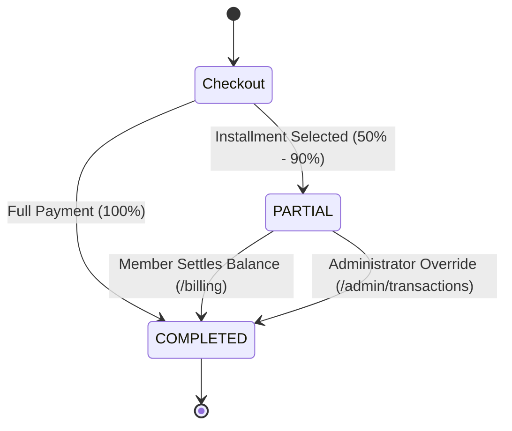

# 🏋️ HyperGym Fitness Subscription Management System

> **AgarkarMedia Technical Product Manager Assessment — Round 1**  
> **Production Stack**: Next.js 16 (App Router), TypeScript 5, Tailwind CSS 4, React 19, Clerk Auth, MongoDB Atlas + Mongoose, React Three Fiber (3D), Motion.

---

## 🌟 Executive Overview & Design Vision

**HyperGym** is a luxury fitness subscription management platform featuring a high-conversion 3D aesthetic ("never-before-seen" fitness metaverse), granular RBAC (Member & Administrator consoles), server-side financial calculation engines, and snapshot-backed billing.

### Key Pillars
- **3D Immersive Hero Scene**: Floating dumbbells, kettlebells, and protein shakers orbiting in zero-gravity with interactive mouse parallax (React Three Fiber + Drei).
- **Dark Luxury Base**: `#0a0a0f` deep space black with Electric Cyan (`#00f0ff`), Neon Magenta (`#ff006e`), and Molten Gold (`#ffd700`) accents.
- **Evaluator Demo Toolbar**: Floating bottom-right control pill enabling instantaneous role switching (Member ⇄ Administrator) and 3-day expiry simulation without manual database edits.
- **Immutable Plan Snapshot Architecture**: Historical transactions and invoices are frozen at the exact millisecond of purchase, ensuring future admin price edits or plan deactivations never distort accounting ledgers.

---

## 🏗️ Architecture & System Design

```
src/
├── app/
│   ├── (public)/                   # Landing Page (3D Hero, Plans, Stats, About)
│   ├── (auth)/                     # Split-screen Clerk SignIn & SignUp
│   ├── (user)/
│   │   ├── dashboard/              # Active plan card, 3-day expiry alert, upgrade grid
│   │   ├── checkout/[planId]/      # Full vs installment (50–90%) checkout with coupon engine
│   │   └── billing/                # Transaction ledger with printable snapshot invoice modal
│   ├── (admin)/admin/
│   │   ├── dashboard/              # Executive KPI Command Center & Revenue Metrics
│   │   ├── plans/                  # Plan Manager CRUD + Version increment triggers
│   │   ├── coupons/                # Coupon Engine (FLAT / PERCENTAGE discounts)
│   │   └── transactions/           # Global ledger + Atomic partial-to-completed override
│   ├── api/webhooks/clerk/         # Svix-verified Clerk webhook handler
│   └── auth-callback/              # Post-login RBAC router
├── components/
│   ├── three/                      # 3D Canvas, Floating equipment, Particle field
│   ├── landing/                    # Kinetic typography, Stats counter, Testimonials
│   ├── checkout/                   # Slide-over checkout drawer, Live pricing calculator
│   ├── billing/                    # Printable snapshot tax invoice modal
│   ├── admin/                      # Plan CRUD modal, Coupon form, Transaction table
│   └── demo/                       # Evaluator Demo Toolbar
├── lib/
│   ├── db.ts                       # Cached Mongoose singleton connection
│   ├── pricing.ts                  # Pure financial math (Gross, Plan Discount, Coupon, Installment)
│   ├── invoice.ts                  # INV-YYYYMM-XXXX generator
│   └── actions/                    # Next.js Server Actions (plans, coupons, checkout, billing, admin)
└── models/                         # Mongoose schemas: SubscriptionPlan, User, Transaction, Coupon
```

---

## 📸 Deliverable: Immutable Plan Snapshot Strategy

### The Problem
In subscription platforms, administrators frequently update base monthly prices, adjust plan-level discounts, or archive obsolete tiers. If transactions or invoices only store a foreign key reference (`planId`), historical invoices dynamically recalculate at current prices—causing legal compliance failures, GST tax discrepancy audits, and user confusion.

### The Solution: Embedded Snapshot Pattern
When a subscriber completes checkout (full or partial installment), the application takes an **immutable point-in-time snapshot** and embeds it directly into the `Transaction` document:

```typescript
// Embedded Plan Snapshot in Transaction Schema
planSnapshot: {
  name: "Pro Hypertrophy",            // Exact name at checkout
  durationMonths: 3,                   // Term duration
  baseMonthlyPrice: 2199,              // Rate at purchase time
  planDiscountPercentage: 12,          // Plan-level discount %
  grossAmount: 6597,                   // duration × basePrice
  planDiscountAmount: 792,             // Gross × discount %
  couponCode: "WELCOME10",             // Applied coupon
  couponDiscountAmount: 581            // Subtotal × coupon %
}
```

### Versioning Mechanism
1. Whenever an Administrator alters a plan's `baseMonthlyPrice`, `discountPercentage`, or `durationMonths`, the system automatically increments `plan.version = plan.version + 1`.
2. Existing subscribers remain tied to their snapshot.
3. New checkouts capture the incremented version.
4. Historical invoices generated in `/billing` render purely from `planSnapshot`, guaranteeing 100% accounting immutability.

---

## 💳 Business Logic & Financial Formulas

### Pricing Calculation
```
Gross Total    = durationMonths × baseMonthlyPrice
Plan Discount  = Gross Total × (discountPercentage / 100)
Subtotal       = Gross Total - Plan Discount

If Coupon (PERCENTAGE): Coupon Discount = Subtotal × (couponValue / 100)
If Coupon (FLAT):       Coupon Discount = min(couponValue, Subtotal)

Final Total    = max(0, Subtotal - Coupon Discount)
```

### Partial Payment State Machine


---

## 🌿 Git Branching Strategy & History

This repository strictly follows the planned GitFlow strategy:
- `main`: Production-ready release branch
- `develop`: Integration branch
- `feature/*`: Dedicated scoped feature branches merged with `--no-ff`

---

## 🚀 Quickstart & Setup Guide

### 1. Prerequisites
- Node.js 20+
- pnpm 10+ (`npm i -g pnpm`)

### 2. Installation
```bash
# Clone the repository
git clone <repo-url>
cd "Fitness subscription system"

# Install dependencies
pnpm install
```

### 3. Environment Variables
Copy `.env.example` to `.env.local`:
```bash
cp .env.example .env.local
```

Configure your credentials:
```env
# MongoDB Atlas
MONGODB_URI=mongodb+srv://<username>:<password>@cluster.mongodb.net/hypergym?retryWrites=true&w=majority

# Clerk Authentication (Optional for demo mode — Evaluator Toolbar works out of the box!)
NEXT_PUBLIC_CLERK_PUBLISHABLE_KEY=pk_test_...
CLERK_SECRET_KEY=sk_test_...
CLERK_WEBHOOK_SECRET=whsec_...
```

### 4. Running the Application
```bash
# Start Next.js development server
pnpm dev
```
Open [http://localhost:3000](http://localhost:3000) in your browser.

---

## 🧪 Evaluator Verification Guide

### 1. Testing Without Clerk Keys (Zero Configuration)
- Navigate to [http://localhost:3000/sign-in](http://localhost:3000/sign-in).
- Click **"Sign In as Member"** or **"Sign In as Admin"**.
- Alternatively, use the **Evaluator Toolbar** (bottom-right floating pill) on any page to switch roles instantly.

### 2. Testing 3-Day Expiry Banner
- Click **Demo Controls** in the bottom-right corner.
- Click **"Simulate 3-Day Expiry Alert"**.
- The page reloads with the red urgent expiration banner and countdown on `/dashboard`.

### 3. Testing Partial Payment & Admin Override
1. Open `/checkout/pro`.
2. Toggle to **"Installment Plan"**, adjust the slider to 50%, and click **Pay & Activate**.
3. Go to `/billing` to view the invoice in `PARTIAL` status with remaining balance due.
4. Switch to **Admin View** using the Evaluator Toolbar.
5. Go to `/admin/transactions` and locate the partial invoice.
6. Click **"Override to COMPLETED"**, enter audit clearance notes, and confirm.
7. Return to Member view: the invoice is now `COMPLETED` and the user's balance due is ₹0.

### 4. Testing Coupon Codes
Try the following pre-seeded promotional codes during checkout:
- `WELCOME10`: 10% off
- `FITHALF`: 50% off
- `FLAT1000`: Flat ₹1,000 off (Minimum purchase ₹5,000)

---

## 📜 Assessment Deliverables Checklist

- [x] **Next.js 14+ / 16 App Router** with TypeScript and Tailwind CSS
- [x] **Mongoose MongoDB Schemas**: SubscriptionPlan, User, Transaction, Coupon
- [x] **Clerk Auth & Svix Webhook** synchronization with RBAC middleware
- [x] **3D Immersive Aesthetic**: React Three Fiber zero-gravity hero
- [x] **Full & Partial Payment Engine**: 50%–90% installment slider
- [x] **Coupon Engine**: Flat & percentage validation with minimum cart rules
- [x] **Member Dashboard**: 3-Day expiry alert, activation state, upgrade grid
- [x] **Printable Tax Invoices**: Immutable point-in-time plan snapshots
- [x] **Admin Management**: Plan CRUD, Coupon CRUD, Versioning, and Atomic Override
- [x] **Git Branching Strategy**: Full GitFlow execution with clean commit history
