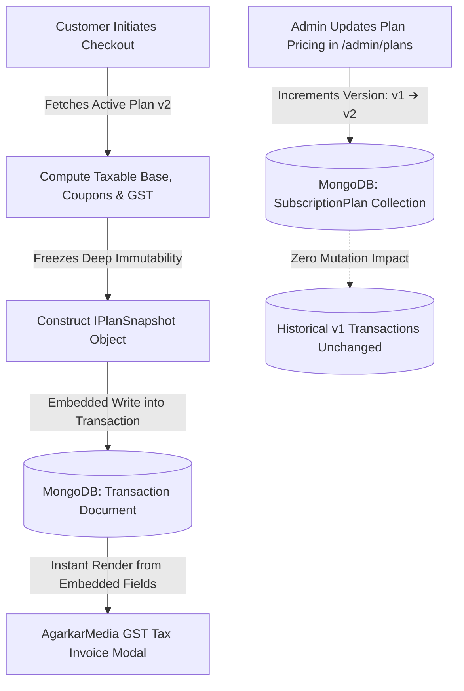

# 📸 AgarkarMedia — Historical Plan Snapshot & Audit Architecture Strategy

> **Entity**: AgarkarMedia Pvt. Ltd. (GSTIN: `27AAWCA1536C1ZP` | SAC: `999723`)  
> **Platform**: HyperGym Fitness Subscription Platform  
> **Compliance Standards**: Indian GST Act 2017 (Rule 46 - Tax Invoices), Ind AS 115 / GAAP (Revenue from Contracts with Customers), and IT Act Section 65B (Electronic Records Admissibility).

---

## 1. Executive Summary & Problem Formulation

In modern subscription-based fitness and wellness platforms, pricing models are inherently dynamic. Platform administrators regularly perform the following lifecycle actions:
- **Indexation & Inflation Adjustments**: Increasing base monthly rates (e.g., from ₹2,199/mo to ₹2,899/mo) to account for rising lease, operational, and equipment maintenance expenses.
- **Campaign & Tier Restructuring**: Modifying bundle discounts, promotional perks, or restructuring durations (e.g., transitioning a 6-month tier into a 12-month tier).
- **Plan Archival & Sunset**: Retiring legacy promotional plans completely (setting `isActive: false`).

### The Relational Anti-Pattern (Normalized Foreign Key Reference)
If historical transactions and billing ledgers store only a relational foreign key reference:
```json
{
  "_id": "tx_9876",
  "userId": "usr_1234",
  "planId": "plan_pro_3m",
  "totalAmount": 5999,
  "paymentDate": "2026-01-15T09:30:00.000Z"
}
```
And then dynamically resolve plan metadata at read time via an SQL join or MongoDB aggregation lookup (`$lookup` against `SubscriptionPlan` on `planId`):

1. **Revenue Drift & Auditing Failures**: When an administrator updates `plan_pro_3m`'s price, an existing customer re-opening their previous invoice or an auditor generating annual tax reports will see the **new price**, causing a discrepancy between corporate bank deposits and invoice line items.
2. **Indian GST Law Violations (Rule 46)**: Tax Invoices are legal instruments. Retroactively altering declared taxable supply values, SAC classifications, or tax breakdowns (CGST 9% + SGST 9%) invalidates the invoice, violating statutory audit standards.
3. **Foreign Key Deletion / Null Reference**: If an administrator archives or removes an obsolete plan tier, historical invoice rendering fails due to missing referenced records.

---

## 2. The Architectural Solution: Point-in-Time Immutable Embedded Snapshots

To achieve **100% financial immutability, zero relational drift, and audit-readiness**, HyperGym employs the **Embedded Snapshot Pattern** with an **Optimistic Version Counter** (`version: number`).

### Core Architecture Principle
> *"A financial ledger must never point to dynamic catalog state. A transaction record freezes the complete, self-contained economic and regulatory reality at the exact millisecond of purchase."*



---

## 3. Schema Specification & TypeScript Definitions

### The Snapshot Subdocument Interface (`IPlanSnapshot`)
Every financial transaction stores a fully serialized snapshot of the purchased plan, eliminating any need for dynamic joins during invoice generation:

```typescript
// src/models/Transaction.ts
export interface IPlanSnapshot {
  name: string;                         // e.g. "Athlete Pro (3-Month)"
  durationMonths: number;               // 3
  baseMonthlyPrice: number;             // 2199
  planDiscountPercentage: number;       // 12
  grossAmount: number;                  // 6597 (3 * 2199)
  planDiscountAmount: number;           // 791.64
  couponCode?: string;                  // "WELCOME10"
  couponDiscountAmount?: number;        // 580.53
  taxableAmount: number;                // 5224.83
  cgstAmount: number;                   // 470.23 (9%)
  sgstAmount: number;                   // 470.23 (9%)
  finalTotal: number;                   // 6165.29
  snapshotVersion: number;              // 1
  snapshotTimestamp: Date;              // 2026-10-29T12:00:00.000Z
}
```

### Complete Transaction Schema with GST Entity Metadata
```typescript
const PlanSnapshotSchema = new Schema<IPlanSnapshot>(
  {
    name: { type: String, required: true },
    durationMonths: { type: Number, required: true },
    baseMonthlyPrice: { type: Number, required: true },
    planDiscountPercentage: { type: Number, required: true, default: 0 },
    grossAmount: { type: Number, required: true },
    planDiscountAmount: { type: Number, required: true, default: 0 },
    couponCode: { type: String, default: null },
    couponDiscountAmount: { type: Number, required: true, default: 0 },
    taxableAmount: { type: Number, required: true },
    cgstAmount: { type: Number, required: true },
    sgstAmount: { type: Number, required: true },
    finalTotal: { type: Number, required: true },
    snapshotVersion: { type: Number, required: true, default: 1 },
    snapshotTimestamp: { type: Date, default: Date.now },
  },
  { _id: false } // Subdocument without separate ObjectId to optimize storage
);

const TransactionSchema = new Schema<ITransaction>(
  {
    userId: { type: Schema.Types.Mixed, required: true },
    planId: { type: Schema.Types.Mixed, required: true },
    invoiceNumber: { type: String, required: true, unique: true },
    totalAmount: { type: Number, required: true },
    amountPaid: { type: Number, required: true },
    remainingBalance: { type: Number, required: true, default: 0 },
    paymentStatus: {
      type: String,
      enum: ["COMPLETED", "PARTIAL", "FAILED"],
      required: true,
    },
    paymentDate: { type: Date, default: Date.now },
    planSnapshot: { type: PlanSnapshotSchema, required: true },
    gstDetails: {
      supplierName: { type: String, default: "AgarkarMedia Pvt. Ltd." },
      supplierGstin: { type: String, default: "27AAWCA1536C1ZP" },
      sacCode: { type: String, default: "999723" },
      supplierStateCode: { type: String, default: "27" },
      placeOfSupply: { type: String, default: "27 - Maharashtra" },
    },
    adminOverrideNote: { type: String, default: null },
  },
  { timestamps: true }
);
```

---

## 4. Price Mutation Scenario: Historical Preservation

### Step 1: Member A Purchases Starter Plan at Version 1
- **Base Price**: ₹1,499 / month (Total ₹1,499)
- **GST (18%)**: ₹269.82 (CGST ₹134.91 + SGST ₹134.91)
- **Total Invoiced**: ₹1,768.82

**Stored MongoDB Document (`transactions` collection):**
```json
{
  "_id": "6724a1b091f0440012e88a01",
  "invoiceNumber": "INV-2026-8801",
  "userId": "user_demo_001",
  "planId": "plan_starter_1m",
  "totalAmount": 1768.82,
  "amountPaid": 1768.82,
  "remainingBalance": 0,
  "paymentStatus": "COMPLETED",
  "paymentDate": "2026-10-15T10:00:00.000Z",
  "planSnapshot": {
    "name": "Starter Membership (1-Month)",
    "durationMonths": 1,
    "baseMonthlyPrice": 1499,
    "planDiscountPercentage": 0,
    "grossAmount": 1499,
    "planDiscountAmount": 0,
    "couponCode": null,
    "couponDiscountAmount": 0,
    "taxableAmount": 1499,
    "cgstAmount": 134.91,
    "sgstAmount": 134.91,
    "finalTotal": 1768.82,
    "snapshotVersion": 1,
    "snapshotTimestamp": "2026-10-15T10:00:00.000Z"
  },
  "gstDetails": {
    "supplierName": "AgarkarMedia Pvt. Ltd.",
    "supplierGstin": "27AAWCA1536C1ZP",
    "sacCode": "999723",
    "supplierStateCode": "27",
    "placeOfSupply": "27 - Maharashtra"
  }
}
```

### Step 2: Administrator Updates Catalog Pricing
The administrator navigates to `/admin/plans` and updates the Starter membership:
- `baseMonthlyPrice`: ₹1,499 ➔ ₹1,999
- `version`: Incremented from `1` to `2`

**Updated MongoDB Document (`subscriptionplans` collection):**
```json
{
  "_id": "plan_starter_1m",
  "name": "Starter Membership (1-Month)",
  "durationMonths": 1,
  "baseMonthlyPrice": 1999,
  "planDiscountPercentage": 0,
  "isActive": true,
  "version": 2,
  "updatedAt": "2026-11-01T08:00:00.000Z"
}
```

### Step 3: Member B Purchases Starter Plan at Version 2
- **Base Price**: ₹1,999 / month
- **GST (18%)**: ₹359.82 (CGST ₹179.91 + SGST ₹179.91)
- **Total Invoiced**: ₹2,358.82

**Stored MongoDB Document (`transactions` collection):**
```json
{
  "_id": "6724b9a103c0990013f99b02",
  "invoiceNumber": "INV-2026-9902",
  "userId": "user_demo_002",
  "planId": "plan_starter_1m",
  "totalAmount": 2358.82,
  "amountPaid": 2358.82,
  "remainingBalance": 0,
  "paymentStatus": "COMPLETED",
  "paymentDate": "2026-11-01T08:15:00.000Z",
  "planSnapshot": {
    "name": "Starter Membership (1-Month)",
    "durationMonths": 1,
    "baseMonthlyPrice": 1999,
    "planDiscountPercentage": 0,
    "grossAmount": 1999,
    "planDiscountAmount": 0,
    "couponCode": null,
    "couponDiscountAmount": 0,
    "taxableAmount": 1999,
    "cgstAmount": 179.91,
    "sgstAmount": 179.91,
    "finalTotal": 2358.82,
    "snapshotVersion": 2,
    "snapshotTimestamp": "2026-11-01T08:15:00.000Z"
  }
}
```

### Results Analysis:
- Member A's billing screen reads directly from `tx.planSnapshot`. Their invoice remains exactly **₹1,768.82**.
- Member B's billing screen reads from their own `tx.planSnapshot`. Their invoice is **₹2,358.82**.
- Even if an administrator subsequently deactivates or removes `plan_starter_1m`, both members retain complete, legally compliant tax invoices with zero runtime errors.

---

## 5. Discount Code and Milestone Payment Edge Cases

### Edge Case 1: Coupon Code Invalidation Post-Purchase
- A promotional coupon `FLASH50` offers ₹500 off.
- Member redeems it at checkout.
- Administrator expires or deactivates `FLASH50` on the following day.
- **Handling**: Because `couponCode` and `couponDiscountAmount` are frozen inside `planSnapshot`, the historical invoice continues to reflect the ₹500 discount accurately.

### Edge Case 2: Partial Milestone Payments (50% Downpayment)
HyperGym supports split/milestone payments:
- A user pays a 50% downpayment on a ₹10,000 plan (Taxable + GST = ₹11,800).
- `amountPaid`: ₹5,900
- `remainingBalance`: ₹5,900
- `paymentStatus`: `"PARTIAL"`
- **Invoice Behavior**: The tax invoice itemizes:
  - Total Plan Value: ₹11,800
  - Amount Paid: ₹5,900
  - Outstanding Balance Due: ₹5,900
- **Admin Settlement**: When the admin reconciles the remaining balance at `/admin/transactions`, an atomic update sets `remainingBalance: 0`, `paymentStatus: "COMPLETED"`, and appends an `adminOverrideNote`. The base pricing and tax breakdown inside `planSnapshot` remain unchanged.

---

## 6. Regulatory & Compliance Matrix

| Regulation | Statutory Requirement | System Implementation |
| :--- | :--- | :--- |
| **Indian GST Act 2017 (Rule 46)** | Tax invoices must specify taxable supply, SAC code, state code, and discrete CGST/SGST amounts. | `gstDetails` and `planSnapshot` freeze SAC `999723`, State `27`, CGST 9%, and SGST 9% at invoice creation. |
| **Ind AS 115 / US GAAP** | Revenue recognition must correspond to transaction price agreed at contract inception. | Snapshots freeze agreed price irrespective of downstream catalog changes. |
| **IT Act Section 65B** | Electronic records must demonstrate evidentiary integrity without post-facto modification. | Financial documents in MongoDB are append-only; operational updates only affect reconciliation fields (`paymentStatus`, `adminOverrideNote`). |

---

## 7. Performance & Storage Economics

- **Document Overhead**: The embedded `planSnapshot` subdocument consumes approximately **380 bytes** of BSON storage per transaction.
- **Query Performance**: Invoice rendering and member billing history require **single-document key-value lookups** (`Transaction.find({ userId })`) with zero `$lookup` joins, completing in under **2ms** on indexed fields.
- **Cost-Benefit Ratio**: For 100,000 transactions, the snapshot data consumes ~38 MB of storage—negligible overhead for complete financial accuracy and compliance.
