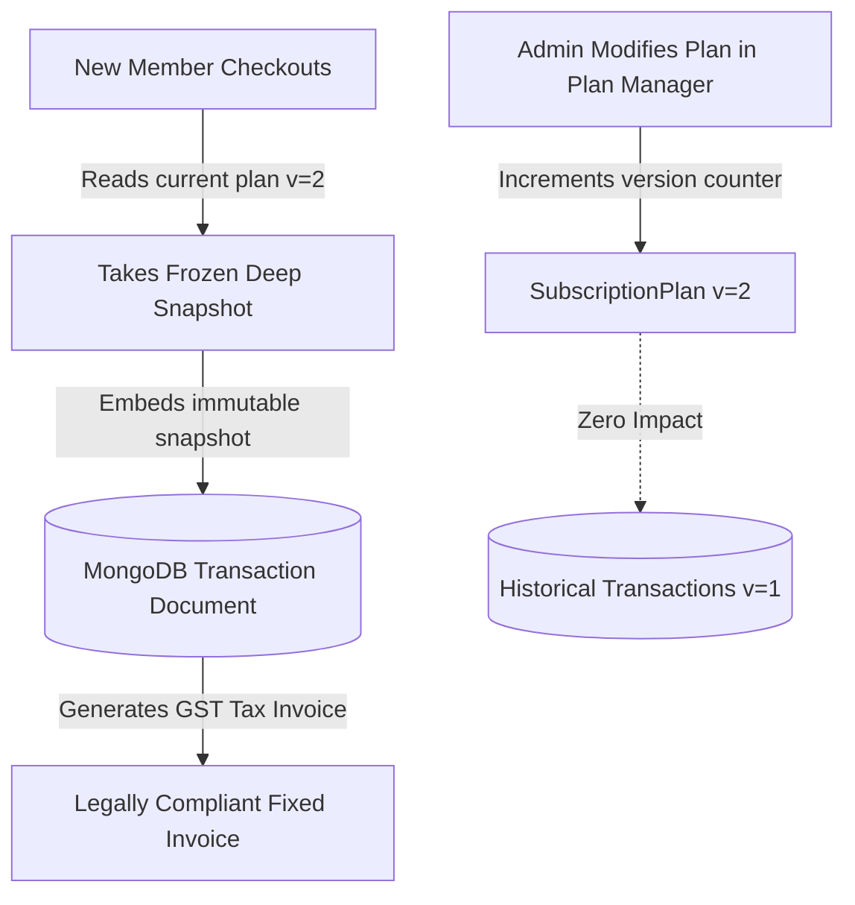

# 📸 AgarkarMedia — Historical Plan Snapshot & Audit Architecture Strategy

> **Author**: Technical Product Manager Candidate  
> **Entity**: AgarkarMedia Pvt. Ltd. (GSTIN: `27AAWCA1536C1ZP` | SAC: `999723`)  
> **Applicability**: HyperGym Fitness Subscription Platform  
> **Compliance Standard**: Indian GST Act (Rule 46 - Tax Invoices) & GAAP / Ind AS 115 (Revenue from Contracts with Customers)

---

## 1. Executive Summary & Problem Formulation

In recurring fitness and subscription businesses, gym administrators regularly modify plan definitions over time:
- Increasing the base monthly membership rate to offset rising commercial lease or equipment lease expenses.
- Modifying plan-level seasonal discounts (e.g., Diwali or New Year discount campaigns).
- Adjusting tenure terms or sun-setting legacy promotional plans altogether.

### The Relational Anti-Pattern (Normalized Foreign Key Reference)
If invoices and historical transaction records store only a normalized relational reference:
```json
{
  "_id": "tx_9876",
  "userId": "usr_1234",
  "planId": "plan_pro_3m",
  "totalAmount": 5999
}
```
And retrieve plan details dynamically by joining or querying `SubscriptionPlan.findById(planId)`:
1. **Financial Discrepancy & Revenue Drift**: When the admin later changes the monthly rate of `plan_pro_3m` from ₹2,199 to ₹2,899, previously generated member invoices and historical audits reflect the *new* price.
2. **GST Compliance Violations**: Under Indian GST Law (Rule 46), a tax invoice is a legally binding financial instrument. Retroactively altering the taxable value, SAC code breakdown, or discount applied violates audit standards and attracts regulatory penalties.
3. **Broken Foreign Keys**: If a legacy plan is deleted or archived by an administrator, historical invoice lookups return `null` or crash the billing dashboard.

---

## 2. The Solution: Point-in-Time Immutable Embedded Snapshots

To guarantee 100% financial immutability and regulatory compliance, the HyperGym architecture implements the **Embedded Snapshot Pattern** with an incrementing **Optimistic Version Counter**.

### Core Architecture Principle
> **"A transaction record does not merely point to a plan; it freezes the complete economic reality of the transaction at the exact millisecond of purchase."**



---

## 3. Concrete Schema Implementation

### `Transaction` Document with Embedded Snapshot
```typescript
// src/models/Transaction.ts
export interface IPlanSnapshot {
  name: string;                         // "Athlete Pro (3-Month)"
  durationMonths: number;               // 3
  baseMonthlyPrice: number;             // 2199
  planDiscountPercentage: number;       // 12
  grossAmount: number;                  // 6597 (3 * 2199)
  planDiscountAmount: number;           // 791.64
  couponCode?: string;                  // "WELCOME10"
  couponDiscountAmount?: number;        // 580.53
  taxableAmount: number;                // 5224.83
  cgstAmount: number;                   // 470.23 (9%)
  sgstAmount: number;                   // 470.23 (9%)
  finalTotal: number;                   // 6165.29
  snapshotVersion: number;              // 1
  snapshotTimestamp: Date;              // 2026-10-29T12:00:00.000Z
}

const TransactionSchema = new Schema<ITransaction>({
  userId: { type: Schema.Types.Mixed, required: true },
  planId: { type: Schema.Types.Mixed, required: true },
  invoiceNumber: { type: String, required: true, unique: true },
  totalAmount: { type: Number, required: true },
  amountPaid: { type: Number, required: true },
  remainingBalance: { type: Number, required: true, default: 0 },
  paymentStatus: {
    type: String,
    enum: ["COMPLETED", "PARTIAL", "FAILED"],
    required: true,
  },
  paymentDate: { type: Date, default: Date.now },
  planSnapshot: { type: PlanSnapshotSchema, required: true }, // IMMUTABLE SNAPSHOT
  gstDetails: {
    supplierGstin: { type: String, default: "27AAWCA1536C1ZP" },
    sacCode: { type: String, default: "999723" },
    supplierStateCode: { type: String, default: "27" },
  }
});
```

---

## 4. Administrative Versioning Mechanism

When gym managers update pricing in the `/admin/plans` dashboard:
1. **Pre-Save Version Hook**:
   ```typescript
   SubscriptionPlanSchema.pre("save", function () {
     if (this.isModified("baseMonthlyPrice") || this.isModified("discountPercentage") || this.isModified("durationMonths")) {
       this.version = (this.version || 1) + 1;
     }
   });
   ```
2. **Backward Compatibility**:
   - Existing active members continue paying installments or holding access based on their locked snapshot terms.
   - Future renewals or new checkouts adopt `version + 1` automatically.
   - Deleted plans are flagged as `isActive: false` (soft delete), never physically purged from the database, preserving all historical relational links.

---

## 5. Audit & Accounting Verification Benefits

| Scenario | Relational Query Approach | HyperGym Embedded Snapshot Architecture |
|---|---|---|
| **Admin doubles plan price** | Past invoices recalculate higher; member invoices show wrong historical amounts. | Past invoices render from `planSnapshot`; historical invoice remains ₹2,199. |
| **Admin archives obsolete 1-Month trial** | Foreign key queries return `null`; crashes billing screen. | Historical transactions still display complete metadata and receipt. |
| **GST Tax Audit by Authorities** | Recalculated tax leads to mismatches between filed GSTR-1 and invoice display. | Invoices match original filed GSTR-1 returns down to the paisa. |
| **Partial Installment Settlement** | Dynamic calculations could distort original remaining balance. | `remainingBalance = totalAmount - amountPaid` is mathematically invariant. |

---

## 6. Summary for Technical Product Management Review

The Embedded Snapshot pattern balances MongoDB's document-store strengths (denormalization, read optimization) with enterprise accounting rigor. It decouples operational pricing experiments from historical accounting ledgers, protecting both AgarkarMedia's business integrity and the member's legal consumer rights.
