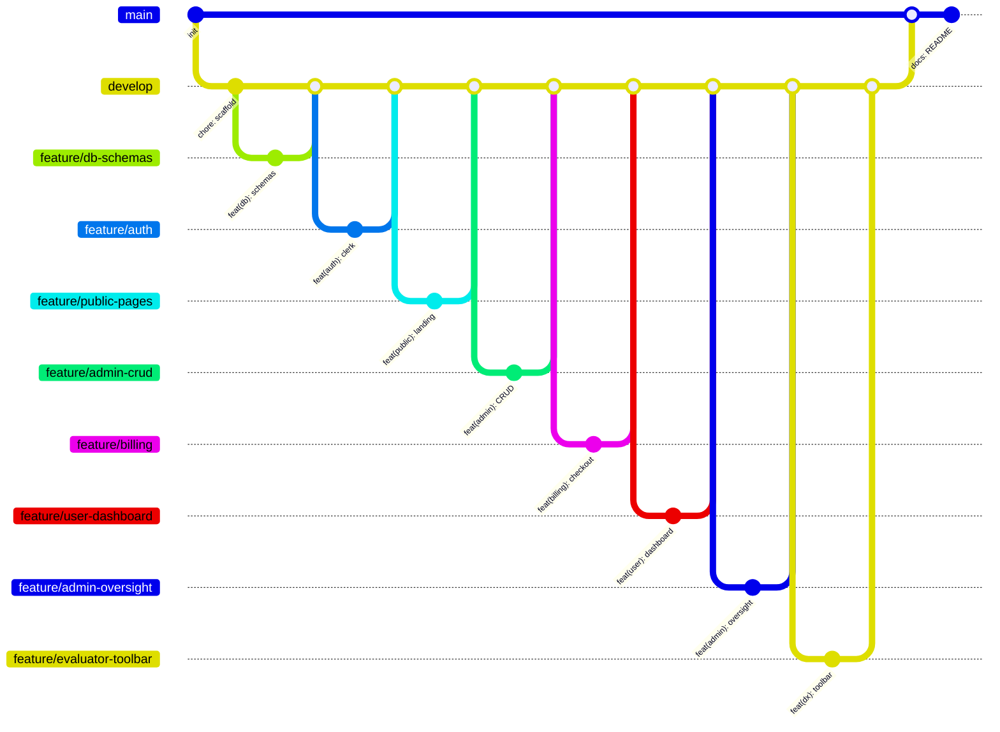
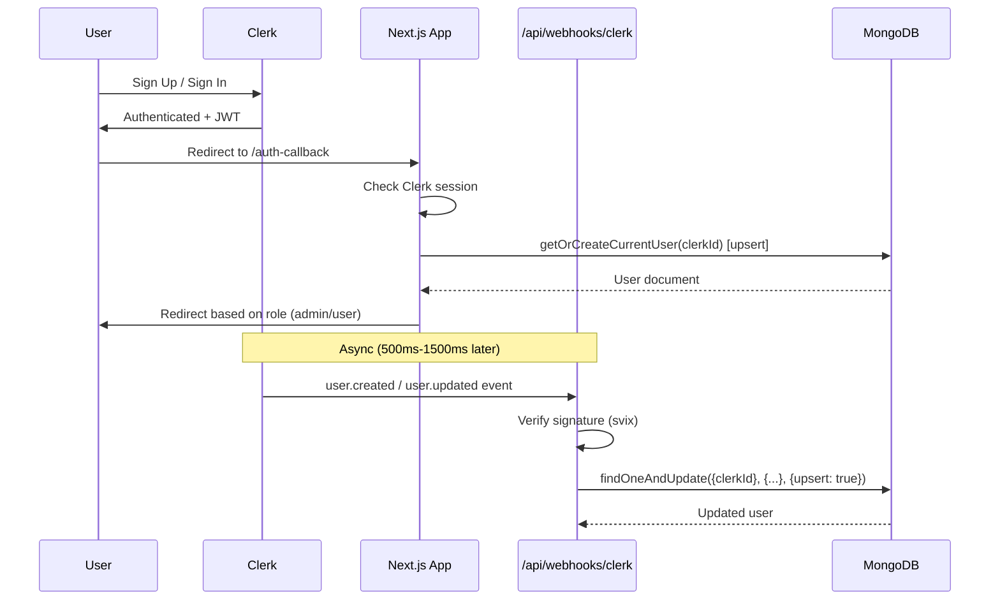
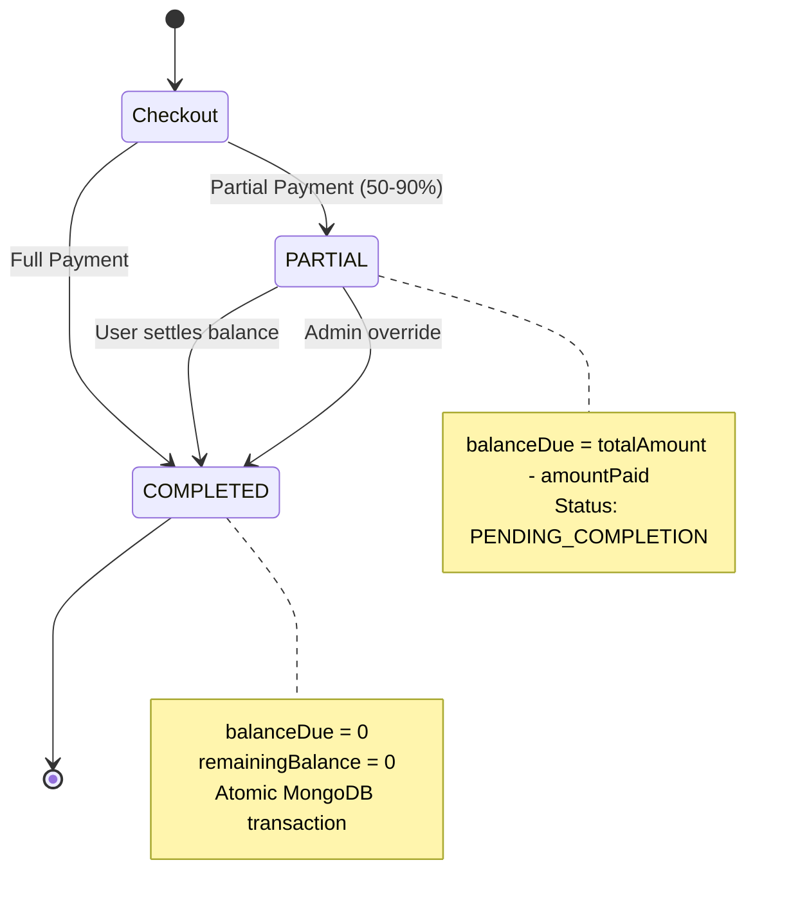

# 🏋️ Fitness Subscription Management System — Implementation Plan

> **Project**: `fitness-subscription-manager`  
> **Assessment**: AgarkarMedia Technical Product Manager — Round 1  
> **Package Manager**: pnpm  
> **Design Direction**: Immersive 3D Fitness Aesthetic — never-before-seen  

---

## Table of Contents

1. [Design Vision & Aesthetic Direction](#1-design-vision--aesthetic-direction)
2. [Complete Tech Stack](#2-complete-tech-stack)
3. [Git Branching Strategy](#3-git-branching-strategy)
4. [Project Structure](#4-project-structure)
5. [Database Architecture](#5-database-architecture)
6. [Authentication & Webhook Architecture](#6-authentication--webhook-architecture)
7. [Business Logic & Financial Math](#7-business-logic--financial-math)
8. [Phase 1 — What We Build NOW](#8-phase-1--what-we-build-now)
9. [Phases 2–10 — Full Execution Roadmap](#9-phases-210--full-execution-roadmap)
10. [Verification Plan](#10-verification-plan)

---

## 1. Design Vision & Aesthetic Direction

### 🎨 The Concept: "HyperGym" — Immersive Fitness Universe

> [!IMPORTANT]
> The goal is to create something evaluators have **never seen** in a subscription dashboard assessment. We're building a fitness platform that feels like stepping into a premium fitness metaverse.

#### Core Design Pillars

| Pillar | Implementation |
|--------|---------------|
| **3D Immersive Hero** | Floating 3D dumbbells, kettlebells, and protein shakers orbiting in zero-gravity using React Three Fiber. Responds to mouse movement with smooth parallax. |
| **Volumetric Depth** | Multi-layer glassmorphism with `backdrop-blur`, inner shadows, and gradient borders creating cards that feel like they float in 3D space. |
| **Kinetic Typography** | Hero text that assembles letter-by-letter with GSAP SplitText, with a subtle glow pulse animation. |
| **Scroll-Driven Storytelling** | Each section reveals via scroll-triggered animations — plans "slam" into view like weights being dropped, stats counter-animate up. |
| **Dark Luxury Base** | Deep `#0a0a0f` to `#12121a` background gradient with accent colors: Electric Cyan `#00f0ff`, Neon Magenta `#ff006e`, Molten Gold `#ffd700` for CTAs. |
| **Micro-Interactions** | Every button has a magnetic hover effect. Cards tilt on hover (3D perspective transform). Skeleton loading with shimmer gradients. |
| **Dashboard: Command Center** | Admin/User dashboards styled like a mission control / gaming dashboard — dark panels, glowing borders, real-time animated KPIs. |

#### Color Palette

```
Background:     #0a0a0f → #12121a (gradient)
Surface:        #1a1a2e (cards, panels)
Surface Hover:  #252540
Border:         rgba(255,255,255,0.06)
Border Active:  rgba(0,240,255,0.3)
Text Primary:   #f0f0f5
Text Secondary: #8888a0
Accent Cyan:    #00f0ff
Accent Magenta: #ff006e
Accent Gold:    #ffd700
Success:        #00e676
Warning:        #ffab00
Danger:         #ff5252
```

#### Typography

- **Headings**: `Space Grotesk` (geometric, modern, tech-forward)
- **Body**: `Inter` (clean readability)
- **Accents/Numbers**: `JetBrains Mono` (for prices, invoice numbers, KPIs)

---

## 2. Complete Tech Stack

> [!WARNING]
> **Next.js Version Strategy**: Next.js 15 reached EOL (Oct 21, 2026). `create-next-app@latest` now scaffolds **Next.js 16**. Since the assessment says "Next.js 14+", using the **latest stable** satisfies this requirement while demonstrating modern tooling proficiency.

### Core (Assessment Required)

| Category | Technology | Version | Notes |
|----------|-----------|---------|-------|
| Framework | Next.js (App Router) | Latest stable | Assessment says "14+", latest satisfies |
| Language | TypeScript | 5.1+ | Required by latest Next.js |
| Auth | Clerk (`@clerk/nextjs`) | 7.x | Major v7 line |
| Webhook Verification | `svix` | latest | Clerk webhook signature verification |
| Database | MongoDB Atlas + Mongoose | 9.x | v9 released Nov 2025 |
| Styling | Tailwind CSS | 4.x | CSS-first config with `@theme` directive |
| Component Library | Shadcn UI | latest | CLI is now `shadcn` (not `shadcn-ui`) |

### 3D & Animation Stack (The "Wow" Factor)

| Package | Purpose | Notes |
|---------|---------|-------|
| `@react-three/fiber` | React renderer for Three.js — 3D hero scenes | v9 for React 19 |
| `@react-three/drei` | Float, Sparkles, Text3D, Environment, ScrollControls | v10+ |
| `three` | Core 3D engine | ^0.170.x |
| `motion` | Page transitions, layout animations, micro-interactions | **Renamed from `framer-motion`** — import from `motion/react` |
| `gsap` + `@gsap/react` | Scroll-triggered animations, SplitText, counters | **Now 100% free** (all plugins) after Webflow acquisition |

### Utility Stack

| Package | Purpose |
|---------|---------|
| `zod` | Schema validation for forms & server actions |
| `react-hook-form` + `@hookform/resolvers` | Admin CRUD forms with Zod integration |
| `recharts` | Admin revenue & analytics charts |
| `@tanstack/react-table` | Filterable/sortable data tables |
| `date-fns` | Billing cycle math, 3-day expiry calculation |
| `sonner` | Toast notifications |
| `lucide-react` | Icon system |
| `next-themes` | Theme management (dark mode default) |

---

## 3. Git Branching Strategy

### Branch Structure



### Branch Naming Convention

| Branch | Purpose |
|--------|---------|
| `main` | Production-ready, final submission |
| `develop` | Integration branch, all features merge here |
| `feature/db-schemas` | Mongoose models & connection |
| `feature/auth` | Clerk auth, webhooks, RBAC middleware |
| `feature/public-pages` | Landing, About, Navbar |
| `feature/admin-crud` | Plan Manager, Coupon Manager |
| `feature/billing` | Pricing grid, checkout, coupon engine |
| `feature/user-dashboard` | User dashboard, alerts, billing history |
| `feature/admin-oversight` | Transaction table, partial→completed override |
| `feature/evaluator-toolbar` | Demo mode toolbar |

### Commit Convention (Conventional Commits)

```
<type>(<scope>): <description>

Types: feat, fix, chore, docs, style, refactor, test
Scopes: db, auth, public, admin, billing, user, dx
```

---

## 4. Project Structure

```
src/
├── app/
│   ├── (public)/
│   │   ├── page.tsx                          # 3D Landing Page + Hero + Plan Previews
│   │   ├── about/page.tsx                    # Mission & Facilities
│   │   └── layout.tsx                        # Public layout with Navbar
│   ├── (auth)/
│   │   ├── sign-in/[[...sign-in]]/page.tsx   # Custom branded Clerk SignIn
│   │   ├── sign-up/[[...sign-up]]/page.tsx   # Custom branded Clerk SignUp
│   │   └── layout.tsx                        # Auth split-screen layout
│   ├── (user)/
│   │   ├── dashboard/page.tsx                # Active Plan, Alerts, Discovery Grid
│   │   ├── checkout/[planId]/page.tsx        # Full vs Partial Checkout + Coupon
│   │   ├── billing/page.tsx                  # Invoices + Snapshot Invoice Modal
│   │   └── layout.tsx                        # User layout with sidebar/nav
│   ├── (admin)/
│   │   └── admin/
│   │       ├── dashboard/page.tsx            # KPI Overview + Quick Actions
│   │       ├── plans/page.tsx                # Plan CRUD Manager
│   │       ├── coupons/page.tsx              # Coupon CRUD Manager
│   │       ├── transactions/page.tsx         # Global Transactions + Override
│   │       └── layout.tsx                    # Admin layout with sidebar
│   ├── api/
│   │   └── webhooks/
│   │       └── clerk/route.ts                # Svix-verified webhook handler
│   ├── auth-callback/page.tsx                # Post-login role redirection
│   ├── layout.tsx                            # Root layout (fonts, providers)
│   └── globals.css                           # Design system tokens
├── components/
│   ├── ui/                                   # Shadcn UI primitives
│   ├── three/                                # 3D Components (client-only)
│   │   ├── HeroScene.tsx                     # Floating gym equipment scene
│   │   ├── FloatingEquipment.tsx             # Individual 3D models
│   │   └── ParticleField.tsx                 # Background particle effects
│   ├── layout/
│   │   ├── Navbar.tsx                        # Auth-aware responsive navbar
│   │   ├── AdminSidebar.tsx                  # Admin navigation sidebar
│   │   └── Footer.tsx                        # Site footer
│   ├── landing/
│   │   ├── HeroSection.tsx                   # 3D hero with CTA
│   │   ├── PlanPreview.tsx                   # Plan cards for landing page
│   │   ├── StatsCounter.tsx                  # Animated stats section
│   │   └── TestimonialSlider.tsx             # Social proof section
│   ├── dashboard/
│   │   ├── ActivePlanCard.tsx                # Current subscription display
│   │   ├── ExpiryAlert.tsx                   # 3-Day expiry warning banner
│   │   ├── ActivationBanner.tsx              # Subscription activation alert
│   │   └── DiscoveryGrid.tsx                 # Plan selection grid
│   ├── checkout/
│   │   ├── CheckoutDrawer.tsx                # Slide-over checkout sheet
│   │   ├── PriceBreakdown.tsx                # Live line-item calculation
│   │   ├── PaymentToggle.tsx                 # Full vs Partial toggle
│   │   ├── PartialPaymentSlider.tsx          # 50%-90% slider
│   │   └── CouponInput.tsx                   # Coupon code with validation
│   ├── billing/
│   │   ├── InvoiceTable.tsx                  # Transaction history table
│   │   ├── InvoiceModal.tsx                  # Printable snapshot invoice
│   │   └── SettleBalanceButton.tsx           # Pay remaining balance CTA
│   ├── admin/
│   │   ├── PlanForm.tsx                      # Plan CRUD form (zod + RHF)
│   │   ├── CouponForm.tsx                    # Coupon CRUD form
│   │   ├── TransactionTable.tsx              # Global transactions
│   │   ├── OverrideAction.tsx                # Partial → Completed override
│   │   └── RevenueChart.tsx                  # Recharts analytics
│   └── demo/
│       └── EvaluatorToolbar.tsx              # Floating demo controls
├── lib/
│   ├── db.ts                                 # Cached Mongoose connection singleton
│   ├── pricing.ts                            # Pure pricing/coupon/partial math
│   ├── invoice.ts                            # Invoice number generation
│   ├── utils.ts                              # Shadcn cn() utility
│   └── actions/
│       ├── plan.actions.ts                   # Plan CRUD server actions
│       ├── coupon.actions.ts                 # Coupon CRUD server actions
│       ├── checkout.actions.ts               # Checkout + snapshot creation
│       ├── billing.actions.ts                # Invoice queries, settle balance
│       ├── admin.actions.ts                  # Override, analytics queries
│       └── demo.actions.ts                   # Evaluator toolbar actions
├── models/
│   ├── User.ts                               # User + activeSubscription schema
│   ├── SubscriptionPlan.ts                   # Plan schema with versioning
│   ├── Transaction.ts                        # Transaction + planSnapshot schema
│   └── Coupon.ts                             # Coupon schema
├── middleware.ts                              # Clerk auth + RBAC route protection
└── types/
    └── index.ts                              # Shared TypeScript interfaces
```

---

## 5. Database Architecture

> [!NOTE]
> All schemas exactly match the assessment's Draft Data Schema requirements plus the extended fields from the plan for edge-case handling.

### 5.1 SubscriptionPlan Schema

| Field | Type | Purpose |
|-------|------|---------|
| `name` | String | Plan display name |
| `description` | String | Plan description for cards |
| `durationMonths` | Number | 1, 3, 6, or 12 |
| `baseMonthlyPrice` | Number | Monthly price in INR |
| `discountPercentage` | Number | Plan-level discount % |
| `allowPartialPayment` | Boolean | Enable installment option |
| `minUpfrontPercentage` | Number | Default 50% min upfront |
| `features` | [String] | Feature list for pricing cards |
| `isPopular` | Boolean | "Most Popular" badge |
| `isActive` | Boolean | Soft-delete flag |
| `version` | Number | Increments on price edits |

### 5.2 User Schema

| Field | Type | Purpose |
|-------|------|---------|
| `clerkId` | String (unique) | Clerk user ID |
| `email` | String | User email |
| `firstName` | String | First name |
| `lastName` | String | Last name |
| `imageUrl` | String | Profile image URL |
| `role` | Enum: ADMIN/USER | Role for RBAC |
| `activeSubscription.planId` | ObjectId | Reference to plan |
| `activeSubscription.planNameSnapshot` | String | Frozen plan name |
| `activeSubscription.status` | Enum | ACTIVE/EXPIRED/PENDING_COMPLETION/NONE |
| `activeSubscription.startDate` | Date | Subscription start |
| `activeSubscription.endDate` | Date | Subscription end |
| `activeSubscription.balanceDue` | Number | Remaining partial payment |
| `activeSubscription.lastTransactionId` | ObjectId | Reference to last transaction |

### 5.3 Transaction Schema (with Snapshot)

| Field | Type | Purpose |
|-------|------|---------|
| `userId` | ObjectId | Reference to user |
| `planId` | ObjectId | Reference to plan |
| `invoiceNumber` | String | Auto-generated (INV-YYYYMM-XXXX) |
| `totalAmount` | Number | Final payable after all discounts |
| `amountPaid` | Number | Amount paid so far |
| `remainingBalance` | Number | totalAmount - amountPaid |
| `paymentStatus` | Enum | COMPLETED/PARTIAL/FAILED |
| `paymentDate` | Date | Payment timestamp |
| **`planSnapshot`** | **Embedded Object** | **Immutable point-in-time capture** |
| `planSnapshot.name` | String | Plan name at purchase time |
| `planSnapshot.durationMonths` | Number | Duration at purchase time |
| `planSnapshot.baseMonthlyPrice` | Number | Price at purchase time |
| `planSnapshot.planDiscountPercentage` | Number | Discount at purchase time |
| `planSnapshot.grossAmount` | Number | duration × basePrice |
| `planSnapshot.planDiscountAmount` | Number | Calculated discount |
| `planSnapshot.couponCode` | String? | Applied coupon code |
| `planSnapshot.couponDiscountAmount` | Number | Coupon savings |
| `adminNotes` | String? | Admin override notes |
| `overriddenBy` | String? | Admin clerkId |
| `overriddenAt` | Date? | Override timestamp |

### 5.4 Coupon Schema

| Field | Type | Purpose |
|-------|------|---------|
| `code` | String (unique, uppercase) | Coupon code |
| `discountType` | Enum: FLAT/PERCENTAGE | Type of discount |
| `discountValue` | Number | Amount or percentage |
| `minPurchaseAmount` | Number? | Minimum cart value |
| `maxUsage` | Number | Max redemptions |
| `usedCount` | Number | Current usage count |
| `expiresAt` | Date | Expiration date |
| `isActive` | Boolean | Active/inactive toggle |

---

## 6. Authentication & Webhook Architecture

### Flow Diagram



> [!TIP]
> **Race Condition Solution**: Both the webhook AND `getOrCreateCurrentUser()` use `findOneAndUpdate` with `upsert: true`. This guarantees the user document exists regardless of which path executes first.

### RBAC Middleware Strategy

```
Public Routes:     /, /about, /sign-in, /sign-up, /api/webhooks/*
User Routes:       /dashboard, /checkout/*, /billing
Admin Routes:      /admin/*
Auth Callback:     /auth-callback (redirects by role)
```

---

## 7. Business Logic & Financial Math

### Pricing Formula

```
Gross Total    = durationMonths × baseMonthlyPrice
Plan Discount  = Gross Total × (discountPercentage / 100)
Subtotal       = Gross Total - Plan Discount

If Coupon (PERCENTAGE): Coupon Discount = Subtotal × (couponValue / 100)
If Coupon (FLAT):       Coupon Discount = min(couponValue, Subtotal)

Final Total    = max(0, Subtotal - Coupon Discount)
```

### Partial Payment State Machine



---

## 8. Phase 1 — What We Build NOW

> [!IMPORTANT]
> Phase 1 covers the foundation that everything else builds upon. We create the project, design system, 3D landing page, and git infrastructure.

### Phase 1 Checklist

- [ ] **Initialize Next.js 14+ project** with TypeScript, Tailwind CSS, ESLint
- [ ] **Initialize Shadcn UI** with dark theme as default
- [ ] **Install 3D stack**: `@react-three/fiber`, `@react-three/drei`, `three`, `framer-motion`, `gsap`
- [ ] **Create design system** in `globals.css` — all color tokens, typography, animations
- [ ] **Build responsive Navbar** — auth-aware (Sign In vs Dashboard toggle)
- [ ] **Build 3D Hero Section** — floating gym equipment, particle effects, kinetic text
- [ ] **Build Landing Page sections** — Stats counter, Plan preview cards, Testimonials, Footer
- [ ] **Set up Git repo** — `main` + `develop` branches, initial commit
- [ ] **Configure fonts** — Space Grotesk, Inter, JetBrains Mono from Google Fonts

### Phase 1 Commit

```
chore: initialize nextjs 14 app router with typescript, tailwind, shadcn ui, and 3d stack
```

---

## 9. Phases 2–10 — Full Execution Roadmap

### Phase 2: Database & Models
```
feat(db): configure mongoose singleton connection and define all 4 schemas
```
- Cached Mongoose connection (`lib/db.ts`) with Vercel serverless pattern
- All 4 Mongoose models with TypeScript interfaces
- Index definitions for performance (clerkId, invoiceNumber, planId)

---

### Phase 3: Authentication & Webhooks
```
feat(auth): integrate clerk custom branded auth pages, middleware RBAC, and svix webhook sync
```
- Custom split-screen auth layout (3D particles + Clerk card)
- Clerk middleware for route protection
- Svix webhook handler with `user.created` / `user.updated`
- `getOrCreateCurrentUser()` upsert helper
- Role-based redirect in `/auth-callback`

---

### Phase 4: Public Pages
```
feat(public): build high-conversion landing page, about page, and responsive auth-aware navbar
```
- Complete landing page with all sections
- About page with mission, facilities, team
- Responsive navbar with mobile hamburger menu
- Footer with links and social

---

### Phase 5: Admin CRUD
```
feat(admin): implement plan manager and coupon manager CRUD with zod validation
```
- Admin sidebar layout
- Plan Manager: Create/Edit/Delete plans with Zod forms
- Coupon Manager: CRUD with validation
- Admin KPI dashboard with Recharts

---

### Phase 6: Billing & Checkout
```
feat(billing): build dynamic pricing discovery grid, coupon engine, and full/partial checkout with snapshot
```
- Dynamic pricing grid with plan cards
- Slide-over checkout drawer
- Live price breakdown calculator
- Coupon input with instant validation
- Full vs Partial payment toggle + slider
- Snapshot creation on checkout

---

### Phase 7: User Dashboard
```
feat(user): implement user dashboard with activation/3-day expiry alerts and billing invoice history
```
- Active plan card with status
- Activation banner (emerald green)
- 3-day expiry warning banner (destructive red)
- Billing history table with InvoiceModal
- "Pay Remaining Balance" self-service button

---

### Phase 8: Admin Oversight
```
feat(admin-oversight): add global transaction table and atomic partial-to-completed override
```
- Global transaction table with @tanstack/react-table
- Filter/sort by status, user, date
- Partial → Completed override with MongoDB atomic transaction
- Admin notes & audit trail

---

### Phase 9: Evaluator Demo Toolbar
```
feat(dx): add interactive evaluator demo toolbar for instant role switching and expiry simulation
```
- Floating collapsible pill (bottom-right)
- One-click role switch (USER ⇄ ADMIN)
- Simulate 3-day expiry warning
- Seed sample data button
- Smooth animation with framer-motion

---

### Phase 10: Documentation & Polish
```
docs(readme): add architecture overview, env template, and snapshot strategy write-up
```
- Comprehensive README.md
- `.env.example` template
- Snapshot Strategy write-up (Deliverable #4)
- Final UI polish, responsive testing
- Deploy to Vercel

---

## 10. Verification Plan

### Automated Checks

```bash
# Type checking
pnpm tsc --noEmit

# Lint
pnpm lint

# Build verification
pnpm build
```

### Manual Verification Checklist

| Test Case | Expected Behavior |
|-----------|-------------------|
| Sign up as new user | User created in MongoDB via webhook, redirected to /dashboard |
| Sign in as admin | Redirected to /admin/dashboard |
| Create plan (admin) | Plan appears in discovery grid |
| Apply coupon at checkout | Price updates with correct math |
| Full payment checkout | Transaction COMPLETED, invoice in /billing |
| Partial payment checkout | Transaction PARTIAL, balanceDue shown |
| Admin override partial→completed | Atomic update, balanceDue = 0 |
| 3-day expiry simulation | Warning banner appears on dashboard |
| Plan price change after purchase | Historical invoices show snapshot price |
| Evaluator toolbar role switch | Instant redirect between user/admin views |
| Mobile responsive | All pages work on 375px-1440px+ |
| Invoice modal + print | Clean printable invoice with snapshot data |

---

## Open Questions

> [!IMPORTANT]
> **Q1**: Do you have Clerk API keys ready, or should I set up with placeholder `.env.example` values for now and configure Clerk later?

> [!IMPORTANT]
> **Q2**: For the 3D hero, should I use procedural geometry (code-generated 3D shapes like dumbbells/kettlebells) or would you prefer I generate static 3D-looking images as a simpler alternative? Procedural is more impressive but adds ~200KB to the initial bundle.

> [!IMPORTANT]
> **Q3**: Do you want the Admin to be seeded as the first user automatically (first signup = ADMIN), or should there be a specific admin setup process?

> [!IMPORTANT]
> **Q4**: Currency — should all prices be in INR (₹) as suggested by the assessment's ₹10,000 example, or USD ($)?
